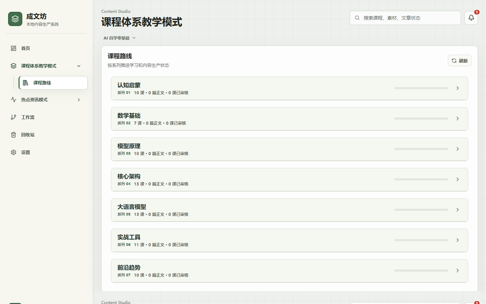
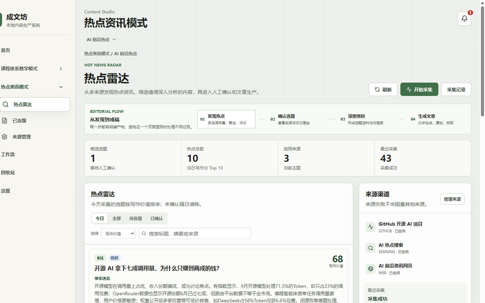
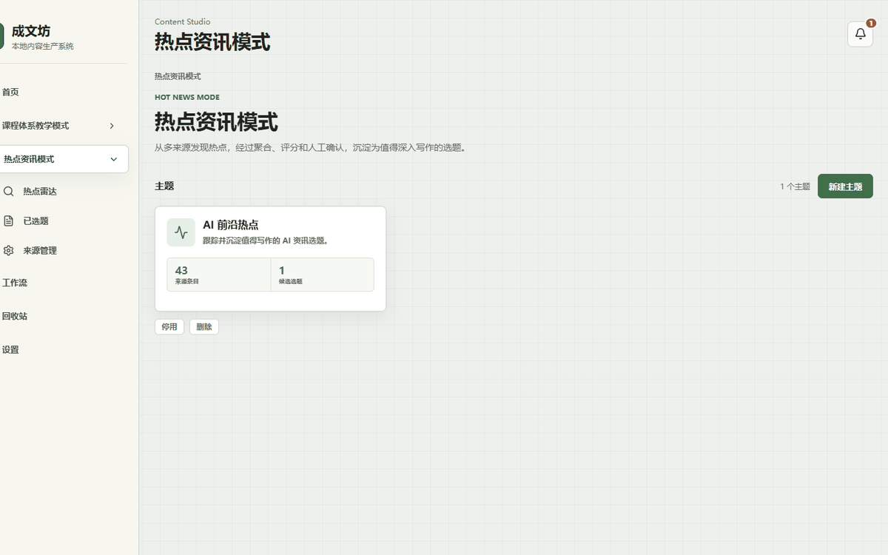

# 成文坊 · Chengwenfang

[](https://github.com/yangJiaBin94/chengwenfang/actions/workflows/ci.yml)
[](LICENSE)
[](https://openjdk.org/)
[](https://spring.io/projects/spring-boot)
[](https://react.dev/)

<p align="center">
  <a href="docs/screenshots/06-course-route.png">
    
  </a><br />
  <sub>课程体系 · 课程路线</sub>
</p>

本机上的个人内容生产工具。用它写课程、改公众号文、把热点分步写成稿；知识库能带着引用回答，证据不够就拒答。数据留在你自己的机器上。

**仅限本机**：默认绑定 `127.0.0.1`。鉴权始终开启（Sa-Token + RBAC + 用户级数据隔离）。种子管理员账号 **`admin` / `admin123`**，首次登录后请立刻改密。请不要对公网暴露；二次开发前先读 [SECURITY.md](SECURITY.md)。Lightpanda 是可选的 AGPL 边车，不是默认档的一部分。

[一键开始](#一键开始课程--知识库) · [体验手册](docs/体验手册.md) · [文档](docs/README.md) · [贡献](CONTRIBUTING.md) · [安全](SECURITY.md)

---

## 给谁用

**作者。** 按课程路线从原稿走到公众号文、配图、排版和审核；热点是加装档。填好设置里的 Key 之后，跟着 [体验手册](docs/体验手册.md) 可以走出第一篇。空库会自己灌入提示词包、三条主工作流和演示主题。

**开发者。** 这是一个 Java 21 模块化单体加 React。业务按 COLA 分层：门面、编排、领域规则分开。提示词包绑在工作流图的节点上，生成走已发布的图，而不是把提示词散落在页面里。架构和 CI 细节在文末可展开区，以及 [CONTRIBUTING.md](CONTRIBUTING.md)。

**二次开发。** 可以加模式、工作流节点、渠道和排版主题。HTTP / SSE 以 [contracts/api-sse-contract.md](contracts/api-sse-contract.md) 为准。已有单实例多用户登录与 `owner_user_id` 隔离，**不是**多租户 SaaS；对公网暴露前仍须自审边界，见 [SECURITY.md](SECURITY.md) 与 [用户鉴权体系设计](docs/用户鉴权体系设计.md)。仓库里的 `.cursor/skills` 是给贡献者的 Agent Skill，不是产品里的「提示词包」。

---

## 一键开始（课程 + 知识库）

默认档包含 MySQL、Redis 和 Qdrant。知识库随 `docker compose up` 一起起来，不是满血档才有。热点搜索、无头浏览器和三条 Python CLI 是加装。

需要：Docker、JDK 21、Maven、Node.js 22 及以上。API Key 仍要你在设置里自己填，种子和仓库都不会写入真实密钥。

### Windows

```powershell
# 仓库根目录
. .\scripts\use-utf8.ps1
powershell -ExecutionPolicy Bypass -File .\scripts\start-java.ps1
```

### macOS / Linux

```bash
chmod +x scripts/start.sh
./scripts/start.sh
```

脚本会拉起 MySQL、Redis、Qdrant，编译并启动后端（8001）和前端（5173）。空库自动导入提示词包与三条主工作流，并种子管理员账号。Python 解释器按操作系统选择各 CLI 目录下的 venv，不用改 `application.yml`。

打开 **http://127.0.0.1:5173**，用种子账号登录：

| 用户名 | 密码 |
|--------|------|
| `admin` | `admin123` |

登录后点右上角头像可改显示名、头像与密码（**务必改密**）。管理员可在 **设置 → 用户管理** 创建其他用户。

然后打开 **设置**，填写多模态（生成）、图像、嵌入三类 Key 并测试连接；再打开 **设置 → 系统就绪**。嵌入 Key 没配、或 Qdrant 只是内存库，这里都不会显示通过。

接着按 [体验手册](docs/体验手册.md) 走课程成文或知识库问答。

| 地址 | 用途 |
|------|------|
| http://127.0.0.1:5173 | 前端（`/api` 代理到 8001） |
| http://127.0.0.1:8001/api/health | 健康检查 |
| http://127.0.0.1:8001/api/system/builtin-ready | 系统就绪（与设置里同一份清单） |
| http://127.0.0.1:6333/readyz | Qdrant |

停止：Windows `.\scripts\stop-java.ps1`；macOS / Linux `kill $(cat .chengwenfang-backend.pid .chengwenfang-frontend.pid)`。

部分 IDE 会把 `start.sh` 的后台进程带走。这时用两个前台终端：`mvn -pl chengwenfang-app -am spring-boot:run` 与 `npm run dev:frontend`。Compose 仍要先 `docker compose up -d --wait`。

### 热点加装（不是默认）

```powershell
powershell -ExecutionPolicy Bypass -File .\scripts\start-java.ps1 -AllDeps
```

```bash
./scripts/start.sh --all-deps
```

这会执行 `docker compose --profile all`（在默认三件套之外加上 SearXNG、Lightpanda、Neo4j 容器），并安装 `article-extract`、`video-transcript`、`page-screenshot`。Neo4j 可以起来，应用侧 Graph 开关仍然默认关闭。没加装时，雷达搜索、JS 页正文和佐证截图会缺，课程和知识库照常。说明见 [体验手册](docs/体验手册.md) 的热点一节。

Lightpanda 官方镜像是 AGPL-3.0。本仓库没有改它的源码，只把它当作可选边车，也不用它绕过验证码或登录墙。

### 可选：后端放进容器

前端仍在本机 Vite。`app` 容器依赖并连接 Compose 里的 `qdrant` 服务名，不会去连容器内部的 `127.0.0.1`。连不上 Qdrant 时进程失败，不会静默改用内存向量库。

```bash
docker compose up -d --wait
docker compose --profile app up -d --build app
npm install && npm run dev:frontend
```

---

## 能做什么

| 侧栏 | 能力 |
|------|------|
| 课程体系 | 主题与课表；原稿 / 公众号文；配图、版本、审核、任务轨迹 |
| 热点资讯 | 雷达、来源、选题资料池、分步成文（加装档更完整） |
| 知识库 | 上传 / 网页 / 作品入库；切块索引；带引用的问答，证据不够则拒答 |
| 工作流 | 三条主工作流图，节点上绑定提示词包 |
| 设置 | AI Key、提示词包、排版主题、系统就绪；管理员另有用户管理（右上角头像可改本人资料/密码） |

<details>
<summary>更多界面</summary>

**热点雷达**

<p align="center">
  <a href="docs/screenshots/05-hotnews-radar.png">
    
  </a>
</p>

**热点走查**

<p align="center">
  <a href="docs/screenshots/hotnews-walkthrough.gif">
    
  </a>
</p>

**课程主题 / 热点主题 / 工作流 / 设置** 见 `docs/screenshots/` 下 `01` 至 `04`。

</details>

---

## 文档

给人看的操作顺序在 [docs/体验手册.md](docs/体验手册.md)。索引在 [docs/README.md](docs/README.md)。交给 AI 助手从零搭满血环境时，用 [docs/AI从零搭建满血成文坊.md](docs/AI从零搭建满血成文坊.md)，那不是人类的主入口。

---

<details>
<summary>部署档、端口并存与 Apple Silicon</summary>

| 档 | 命令 | 容器 |
|----|------|------|
| 课程 + 知识库（默认） | `docker compose up -d --wait` | MySQL、Redis、Qdrant |
| 热点满血 | `docker compose --profile all up -d --wait` | 再加 SearXNG、Lightpanda、Neo4j 容器 |
| 只加 Graph 容器 | `docker compose --profile neo4j up -d` | Neo4j。应用开关默认仍关，要自己设 `chengwenfang.knowledge.graph.enabled=true` |

与另一实例并存：`.\scripts\start-java.ps1 -BesidePrivate -SkipCompose`（后端 8002、前端 5174、Redis database 1）。库名保持 `chengwenfang`，另一实例用不同库名。

macOS Apple Silicon、没有 Homebrew 时：用户目录放 JDK 21 与 Maven，Docker Desktop 可装到 `~/Applications`。引擎若卡在 Rosetta，先 `softwareupdate --install-rosetta`，再在 Docker Desktop 里关掉「Use Rosetta for x86_64/amd64 emulation」。父目录含中文时项目名已固定为 `chengwenfang`。镜像拉取超时时，先从可用镜像站 pull `mysql:8.4`、`redis:7`、`qdrant/qdrant`，`docker tag` 成官方名后再 `docker compose up`。

生产 profile（`--spring.profiles.active=prod`）必须设置 `CHENGWENFANG_SECRET_KEY`，并关闭环回采集。样板见 [.env.example](.env.example)。

</details>

<details>
<summary>模块、技术栈与 CI</summary>

| 层 | 选型 |
|----|------|
| 后端 | Spring Boot 3.3.5（根 `pom.xml` 的 `spring-boot.version`）、Java 21、MyBatis-Plus、Flyway、Redisson |
| 前端 | React 19、Vite 7、TypeScript、Vitest |
| 基础设施 | MySQL 8.4、Redis 7、Qdrant；可选 Neo4j、SearXNG、Lightpanda |
| 工程 | Maven 多模块；Lombok、Hutool、MapStruct |

```text
chengwenfang-app/                 启动与 HTTP
chengwenfang-mode-course/         课程流水线
chengwenfang-mode-hotnews/        雷达、选题、热点成文
chengwenfang-knowledge/           知识库
chengwenfang-content/             主题、作品、产出
chengwenfang-quality/             审核与修复（不是知识库 RAG）
chengwenfang-publishing/          排版与渠道
chengwenfang-sourcing/            信源
chengwenfang-prompt-workflow/     提示词包与工作流图
chengwenfang-file|job|ai|crawler|common|infra/
src/                              React
```

依赖方向和命名见 [docs/代码结构与注释规范.md](docs/代码结构与注释规范.md)、[docs/类命名词典.md](docs/类命名词典.md)。守卫测试是 `ModuleArchitectureTest`。

GitHub Actions 跑 Vitest 和 Maven 单元测试，排除 `*IT` 与 fingerprint 金样。改持久化或 HTTP 时请在本机用 Docker 跑 IT。细节写在 [CONTRIBUTING.md](CONTRIBUTING.md)。Spring Boot 钉在 3.3.x：补丁可跟 Dependabot；升到 3.4 或下一个 major 要单独 PR，并跑单元测试和课程冒烟。

</details>

---

## 贡献与许可

技术讨论可添加作者微信：`Y1990448025`。

欢迎 Issue / PR：[CONTRIBUTING.md](CONTRIBUTING.md)。行为准则：[CODE_OF_CONDUCT.md](CODE_OF_CONDUCT.md)。

[Apache License 2.0](LICENSE) · 第三方说明 [NOTICE](NOTICE) · 变更 [CHANGELOG.md](CHANGELOG.md)
