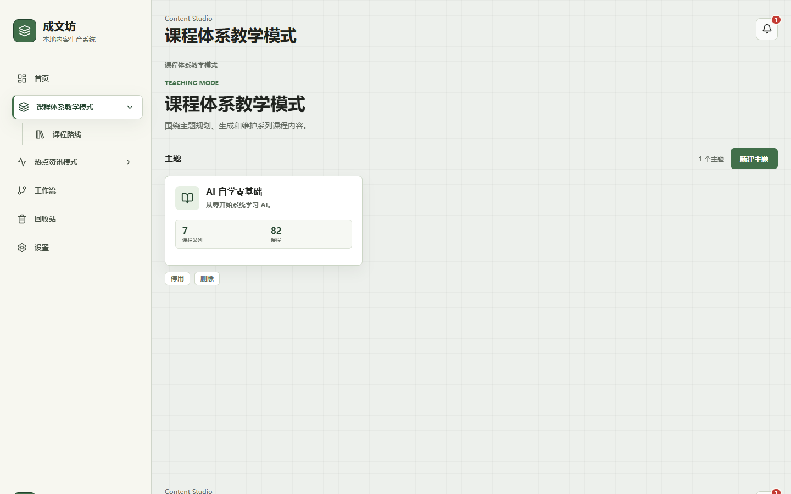
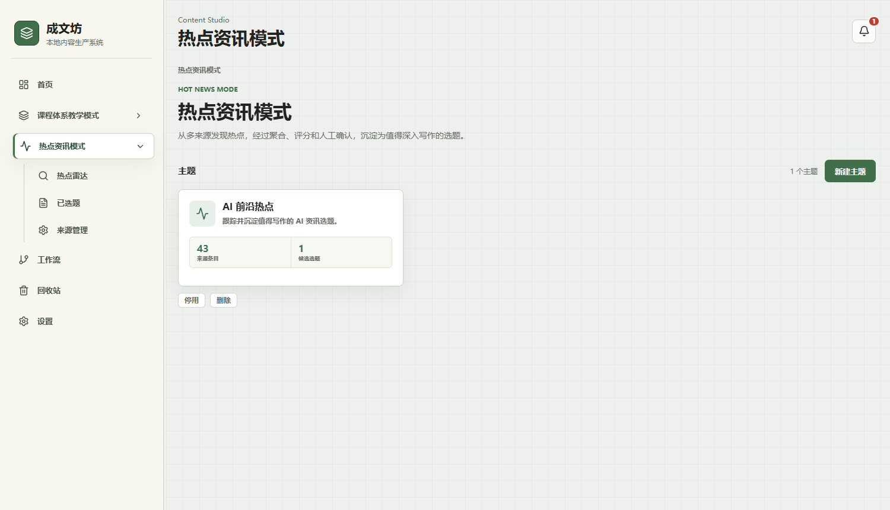
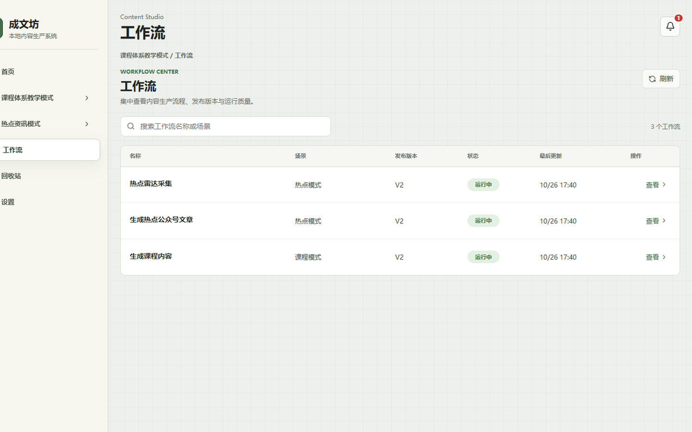
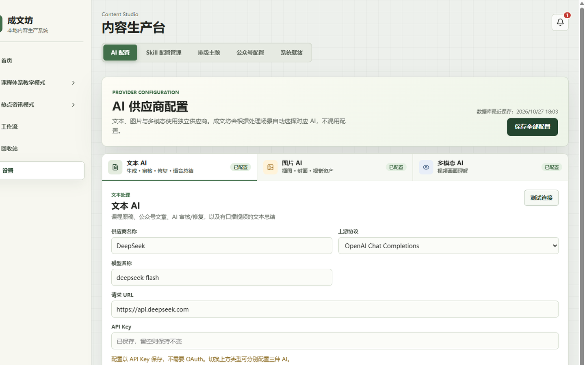
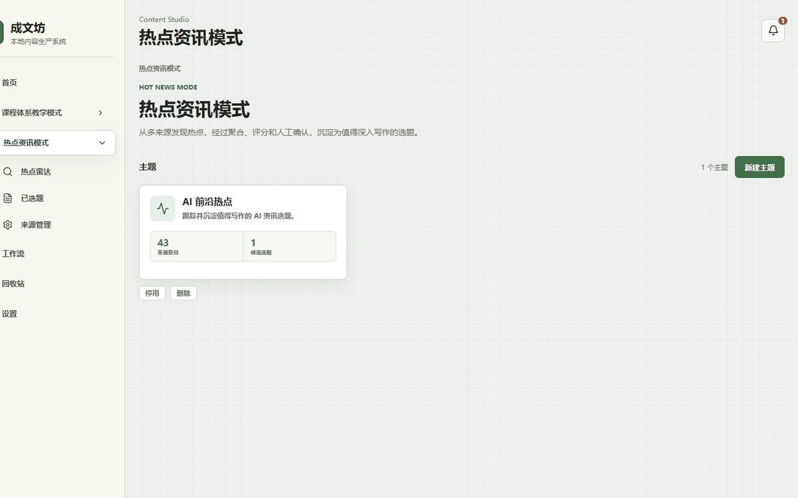

# 成文坊 · Chengwenfang

[](https://github.com/yangJiaBin94/chengwenfang/actions/workflows/ci.yml)
[](LICENSE)
[](https://openjdk.org/)
[](https://spring.io/projects/spring-boot)
[](https://react.dev/)

**本机运行的个人内容生产工具**：课程写作与热点资讯成文共用一套工作流，数据只落在你自己的电脑上。

| 模式 | 链路 |
|------|------|
| 课程体系 | 学习素材 → 原稿 / 公众号文 → 配图 → 排版 → 审核与修复 |
| 热点资讯 | 雷达采集 → 选题与资料池 → 分步生成成文 |

技术形态：Java 21（Spring Boot 3.3）模块化单体 + React / Vite；**无登录、无多人协作**。

> ⚠️ **仅限本机**：默认绑定 `127.0.0.1`，[无鉴权](SECURITY.md)，请勿对公网暴露。  
> 本仓库**不附带**个人课程正文，仅含 bootstrap 演示主题（见 [`content/README.md`](content/README.md)）。

[仅课程快速开始](#快速开始仅课程主流程推荐) · [截图](#界面预览) · [文档](#文档) · [贡献](CONTRIBUTING.md) · [安全](SECURITY.md) · [变更](CHANGELOG.md)

---

## 界面预览

<p align="center">
  
  
</p>
<p align="center">
  
  
</p>
<p align="center">
  
</p>

| 图 | 说明 |
|----|------|
| 课程体系 | 主题卡片、课表入口、新建主题 |
| 热点资讯 | 主题卡片展示来源条目 / 候选选题计数（非空壳） |
| 工作流 | 内置课程生成与热点采集 / 成文流程 |
| 设置 | 文本 / 图片 / 多模态 AI 分供应商配置 |
| GIF | 热点主题列表 → 雷达选题 → 来源管理（短循环） |

---

## 功能一览

| 侧栏 | 能力 |
|------|------|
| 课程体系教学模式 | 主题与课表；原稿 / 公众号文；配图、版本、审核、任务轨迹 |
| 热点资讯模式 | 热点雷达、来源管理、选题资料池与核验、分步生成 |
| 工作流 | Skill 与生成工作流图 |
| 回收站 / 设置 | 恢复已删主题；配置 AI 与本机公众号等 |

课程侧典型路径：

```text
素材与路线 → 课程原稿 → 公众号文章 → 配图
  → 排版（复制 Markdown / 打开 mdnice）→ 审核 → AI 修复 → 人工确认
```

---

## 快速开始（仅课程主流程，推荐）

先跑通课程即可。**不必**装 Python / ffmpeg，也**不必**起 SearXNG / Lightpanda。

需要：Docker Desktop、JDK 21、Maven、Node.js **22+**。

```powershell
# Windows PowerShell · 仓库根目录
. .\scripts\use-utf8.ps1
docker compose up -d --wait          # 仅 MySQL + Redis
npm install
powershell -ExecutionPolicy Bypass -File .\scripts\bootstrap\Initialize-ChengwenfangSeed.ps1

# 终端 1 — 后端
mvn -pl chengwenfang-app -am spring-boot:run
# 终端 2 — 前端
npm run dev:frontend
```

打开 **http://127.0.0.1:5173** → **设置** 填写 AI API Key 并测试连接。

| 地址 | 用途 |
|------|------|
| http://127.0.0.1:5173 | 前端（`/api` → 8001） |
| http://127.0.0.1:8001/api/health | 健康检查 |
| http://127.0.0.1:8001/swagger-ui.html | API 文档（开发） |

一键脚本：

```powershell
# Windows
powershell -ExecutionPolicy Bypass -File .\scripts\start-java.ps1

# macOS / Linux（bash）
chmod +x scripts/start.sh && ./scripts/start.sh
```

**可选：后端跑在 Docker**（前端仍用本机 Vite；不是「全家桶一镜像」；`app` profile 里的密钥/密码是本机开发默认，不是生产样板）：

```powershell
docker compose up -d --wait
docker compose --profile app up -d --build app
npm install && npm run dev:frontend
```

停止后端：`.\scripts\stop-java.ps1`（Windows）、`kill $(cat .chengwenfang-backend.pid .chengwenfang-frontend.pid)`（`start.sh`），或 `docker compose --profile app stop app`。

### 用 AI 从零搭建

交给 Cursor / Codex 等执行：

**[`docs/AI从零搭建满血成文坊.md`](docs/AI从零搭建满血成文坊.md)**

> 请阅读并严格执行 `docs/AI从零搭建满血成文坊.md`。若只要课程主流程：Docker 仅 MySQL/Redis，跳过 Python CLI 与 SearXNG/Lightpanda；直到 `8001/api/health` 与 `5173` 可访问。API Key 留给我在设置页填写。

---

## 热点模式（可选加装）

雷达正文、资料池视频解析才需要下面这些；**跳过不影响课程**。

| 依赖 | 作用 |
|------|------|
| `scripts/article-extract` venv | 网页正文抽取 |
| `scripts/video-transcript` venv + 本机 `ffmpeg` | 视频口播 / 抽帧 |
| `docker compose --profile all` | SearXNG（搜索）+ Lightpanda（JS 页回退） |

```powershell
docker compose --profile all up -d --wait
# 或：.\scripts\start-java.ps1 -AllDeps
# 或：./scripts/start.sh --all-deps
```

Python venv 安装见 [`scripts/article-extract/README.md`](scripts/article-extract/README.md)、[`scripts/video-transcript/README.md`](scripts/video-transcript/README.md)。

---

## 技术栈与结构

| 层 | 选型 |
|----|------|
| 后端 | Spring Boot `3.3.5`（钉版，见下）、Java 21、MyBatis-Plus、Flyway、Redisson、LangChain4j |
| 前端 | React 19、Vite 7、TypeScript、Vitest |
| 基础设施 | MySQL 8.4、Redis 7；可选 SearXNG、Lightpanda |
| 工程 | Maven 多模块 + npm；Lombok / Hutool / MapStruct |

<details>
<summary>Spring Boot 钉版与升级</summary>

版本写在根 `pom.xml` 的 `spring-boot.version`（当前 **3.3.5**），经 `spring-boot-dependencies` BOM 统一管理；不要在子模块另起一套 Boot 版本。

| 策略 | 做法 |
|------|------|
| 为何钉 3.3.x | 与本仓已验证的 MyBatis-Plus / Redisson / springdoc / LangChain4j 组合对齐；公开仓优先可复现，不追每周最新 minor |
| 同 minor 补丁 | 可跟 Dependabot（Maven）升到 3.3.x 最新补丁；合并前跑 `npm test` + `mvn -pl chengwenfang-app -am test` |
| 升到 3.4+ / 下一 major | 先单独 PR：改 `spring-boot.version`，过全量单测与本机课程主流程冒烟；若 starter API 或默认配置行为变化，同步改 `application*.yml` 与适配层 |
| 不做什么 | 不为「徽章好看」跨 minor 盲升；不在 Dockerfile / 文档写死另一套 Boot 号而不改 BOM |

</details>

COLA 分层：Adapter → Application → Facade → Infrastructure。守卫测试：`ModuleArchitectureTest`。详见 [架构 Skill](.cursor/skills/chengwenfang-cola-architecture/SKILL.md)、[`docs/代码结构与注释规范.md`](docs/代码结构与注释规范.md)。

```text
chengwenfang/
├── chengwenfang-app/              # 启动：adapter.web / adapter.worker
├── chengwenfang-mode-course/      # 课程流水线与节点
├── chengwenfang-mode-hotnews/     # 雷达、选题、资料池、热点成文
├── chengwenfang-content/          # 主题、作品、产出、ModeDefinition
├── chengwenfang-quality/          # 审核与修复
├── chengwenfang-publishing/       # 排版、渲染、渠道发布
├── chengwenfang-sourcing/         # 信源与抓取相关表
├── chengwenfang-notification/     # 站内通知
├── chengwenfang-skill-workflow/   # Skill、工作流图
├── chengwenfang-file|job|ai|crawler|common|infra/
├── src/                           # React（Vite）
├── contracts/ docs/ scripts/ deploy/
├── compose.yml  pom.xml  package.json
```

---

## 更多安装与配置

<details>
<summary>环境检查 / winget 示例</summary>

```powershell
winget install Docker.DockerDesktop Microsoft.OpenJDK.21 OpenJS.NodeJS.LTS
# Maven、Python、ffmpeg 按需；装完新开终端
java -version; mvn -version; node -v; docker compose version
```

macOS / Linux：Homebrew 等装齐后跳过 `use-utf8.ps1`；`application.yml` 里 Python 路径需改为 `.venv/bin/python`。

</details>

<details>
<summary>与另一实例并存（端口 / Redis DB）</summary>

默认 **8001 / 5173**、Redis **database=0**。并存时：

```powershell
.\scripts\start-java.ps1 -BesidePrivate -SkipCompose
# 或环境变量 SERVER_PORT=8002 SPRING_DATA_REDIS_DATABASE=1 VITE_DEV_PORT=5174 …
```

库名保持 `chengwenfang`（另一实例可用 `chengwenfang_private`）。

</details>

<details>
<summary>生产 Profile 注意</summary>

```text
--spring.profiles.active=prod
```

- **必须**设置环境变量 `CHENGWENFANG_SECRET_KEY`（无开发默认值，未设置则启动失败）  
- `crawler-allow-loopback=false`（不允许采环回）  
- Swagger 关闭  

本机 Compose / jar 的密钥与 DB 密码从 **`.env`**（或进程环境变量）注入；样板见 [`.env.example`](.env.example)，勿把真实密钥提交进仓。详见 [`SECURITY.md`](SECURITY.md)。

</details>

<details>
<summary>能力依赖矩阵</summary>

| 能力 | 依赖 | 未就绪 |
|------|------|--------|
| 课程主流程 | MySQL + Redis + JDK + Node + AI | 无法开发 |
| 雷达正文 | article-extract；Jina → Trafilatura → Lightpanda → 摘要 | 正文质量下降 |
| SearXNG / Lightpanda | Compose profile | 该渠道或回退不可用 |
| 资料池视频 | video-transcript + ffmpeg + 多模态 AI | 解析失败提示 |

Lightpanda 镜像 AGPL-3.0，本仓未改源码；不用于绕过验证码 / 登录墙。

</details>

---

## 测试与文档

```powershell
. .\scripts\use-utf8.ps1
mvn -pl chengwenfang-app -am test
npm test
```

### CI 门禁（GitHub Actions）

工作流 [`.github/workflows/ci.yml`](.github/workflows/ci.yml) 在 `push` / `pull_request` 上跑两道必过门禁：

| Job | 跑什么 | 不跑什么 |
|-----|--------|----------|
| `frontend` | `npm ci` + Vitest（Node 22） | — |
| `backend` | `mvn -pl chengwenfang-app -am test`，并 **排除** `**/*IT.java`、`ChengwenfangIT`、以及 `golden/fingerprint/**` | 需 Docker / Testcontainers 的集成测试；跨 OS 易因 CRLF 抖动的 fingerprint 金样 |

原因：公开 CI 无稳定的本机 Docker 服务编排时长与密钥，IT 与 fingerprint 金样在 Actions 上易红、成本高；门禁以可复现的单元测试为主。

本地改持久化、HTTP 适配层或整仓冒烟时，请自行跑 IT（需 Docker Desktop）：

```powershell
. .\scripts\use-utf8.ps1
# 与 CI 相同（默认也会跑到 IT，若本机 Surefire 未额外 excludes）
mvn -pl chengwenfang-app -am test
# 或只跑集成套件（类名 *IT）
mvn -pl chengwenfang-app -am test -Dtest='*IT'
```

| 文档 | 说明 |
|------|------|
| [`docs/README.md`](docs/README.md) | 索引 |
| [`docs/AI从零搭建满血成文坊.md`](docs/AI从零搭建满血成文坊.md) | 满血 / AI 部署手册 |
| [`docs/代码结构与注释规范.md`](docs/代码结构与注释规范.md) | 分层与注释 |
| [`docs/类命名词典.md`](docs/类命名词典.md) | 类命名 |
| [`contracts/api-sse-contract.md`](contracts/api-sse-contract.md) | API / SSE |

---

## 贡献与许可

欢迎 Issue / PR：[`CONTRIBUTING.md`](CONTRIBUTING.md)。行为准则：[`CODE_OF_CONDUCT.md`](CODE_OF_CONDUCT.md)。

[Apache License 2.0](LICENSE) · 第三方说明 [`NOTICE`](NOTICE) · 变更 [`CHANGELOG.md`](CHANGELOG.md)
