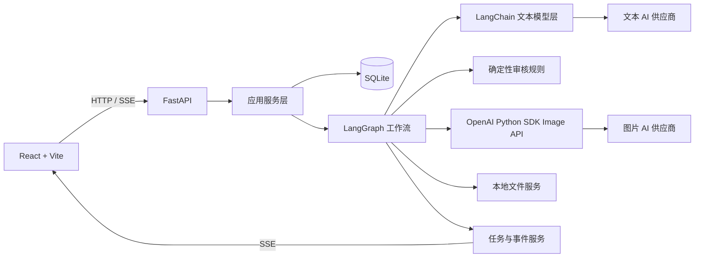

# 工作台技术架构方案

## 1. 文档状态

- 文档版本：2.5
- 更新日期：2026-07-23
- 架构状态：阶段 0-8 已完成，图片生成已迁移到 LangGraph、worker 和 SQLite 文件资产
- 核心决策：保留现有 React 前端和样式，后端改为 FastAPI + SQLAlchemy + LangChain + LangGraph

## 2. 架构目标

- 前后端职责分离。
- 前端不保存业务主数据，不直接调用上游 AI。
- AI 调用、数据库、文件、审核和任务统一由 Python 后端管理。
- 耗时工作流可追踪、可重试、可恢复。
- AI 修复严格遵守版本备份和事务边界。
- 支持自定义 OpenAI 兼容文本供应商和 OpenAI Image API 图片供应商。
- 保持本地单用户、低运维成本。

## 3. 当前架构问题

现有原型使用 Vite 插件承担以下职责：

- AI 协议适配。
- 上游网络请求。
- SQLite 配置存储。
- 错误解析。
- 图片生成。
- 前端开发服务器。

主要问题：

- 前后端耦合。
- 业务逻辑集中在 `App.tsx`。
- 长任务没有可靠状态。
- 浏览器本地版本和数据库版本混用。
- AI 调用失败后难以恢复。
- 缺少数据库迁移和清晰事务边界。
- Vite 插件不适合作为长期业务后端。

## 4. 目标架构



## 5. 技术栈

### 5.1 前端

- React 19。
- TypeScript。
- Vite。
- React Markdown。
- Lucide 图标。
- 现有 CSS 原样保留。

前端只调整 API 调用和状态管理，不重做布局和视觉。

### 5.2 后端

- Python 3.12。
- FastAPI。
- Uvicorn。
- Pydantic 2。
- Pydantic Settings。
- SQLAlchemy 2。
- Alembic。
- SQLite + WAL。
- `aiosqlite`。
- `httpx`。
- `tenacity`。

### 5.3 AI 和工作流

- LangChain：文本模型、提示词、结构化输出。
- `langchain-openai`：OpenAI Chat Completions 和 Responses API。
- LangGraph：生成、审核、修复和复检工作流。
- `langgraph-checkpoint-sqlite`：本地工作流 checkpoint。
- OpenAI Python SDK：`gpt-image-2` Image API。

### 5.4 自动化和测试

- Python Playwright：mdnice 自动化。
- pytest。
- pytest-asyncio。
- Ruff。
- mypy。
- uv：依赖和锁文件管理。

## 6. 项目目录

```text
workbench/
├── src/                         # 现有 React 前端
├── public/
├── content/
├── backend/
│   ├── pyproject.toml
│   ├── uv.lock
│   ├── alembic.ini
│   ├── app/
│   │   ├── main.py
│   │   ├── api/
│   │   │   ├── ai_settings.py
│   │   │   ├── courses.py
│   │   │   ├── articles.py
│   │   │   ├── reviews.py
│   │   │   ├── images.py
│   │   │   └── jobs.py
│   │   ├── core/
│   │   │   ├── config.py
│   │   │   ├── errors.py
│   │   │   ├── logging.py
│   │   │   └── security.py
│   │   ├── db/
│   │   │   ├── session.py
│   │   │   ├── models/
│   │   │   ├── repositories/
│   │   │   └── migrations/
│   │   ├── schemas/
│   │   ├── services/
│   │   ├── workflows/
│   │   ├── ai/
│   │   │   ├── text_models.py
│   │   │   ├── image_client.py
│   │   │   ├── output_schemas.py
│   │   │   └── prompts/
│   │   ├── audit/
│   │   └── workers/
│   └── tests/
├── .workbench/
│   ├── workbench.db
│   ├── generated-images/
│   ├── mdnice-screenshots/
│   └── logs/
└── dist/
```

## 7. 后端分层

### 7.1 API 层

职责：

- HTTP 参数解析。
- Pydantic 校验。
- 调用应用服务。
- 返回统一错误对象。
- SSE 事件输出。

禁止：

- 在路由中写 SQL。
- 在路由中拼接复杂提示词。
- 在路由中直接调用 LangGraph 节点。

### 7.2 应用服务层

服务包括：

- `AiSettingsService`
- `CourseService`
- `ArticleService`
- `ReviewService`
- `VersionService`
- `ImageService`
- `JobService`
- `MdniceService`

职责：

- 业务校验。
- 数据库事务。
- 创建工作流任务。
- 返回前端 DTO。

### 7.3 Repository 层

- 封装 SQLAlchemy 查询。
- 不包含 AI 和提示词逻辑。
- 不返回 ORM 对象给前端。
- 事务由 Service 层控制。

### 7.4 Workflow 层

采用 LangGraph `StateGraph`，节点使用明确函数，不使用通用自主 Agent。

工作流：

- `course_generation_graph`
- `wechat_article_graph`
- `article_review_graph`
- `article_repair_graph`
- `image_generation_graph`
- `mdnice_automation_graph`

## 8. LangChain 设计

### 8.1 模型适配

阶段 5 已使用 `langchain-openai` 的 `ChatOpenAI` 实现统一模型工厂。Chat Completions 使用默认聊天协议，Responses API 使用 `use_responses_api=True`；LangChain 内部重试关闭，由工作台适配层统一执行并记录实际重试次数。

统一接口：

```python
class TextModelFactory:
    def create(self, provider_config: TextProviderConfig) -> BaseChatModel:
        ...
```

文本协议：

- OpenAI Chat Completions。
- OpenAI Responses API。

配置来源：数据库，不从浏览器直接传 API Key 到每次业务请求。

字段：

- 供应商名称。
- Base URL。
- API Key。
- 模型名称。
- 协议。
- 超时。
- 最大重试次数。
- 温度。
- 最大输出长度。
- 是否启用。

### 8.2 自定义兼容层

部分中转供应商只实现 OpenAI API 的子集。模型层需保留自定义 Adapter：

- 规范化请求参数。
- 处理非标准错误格式。
- 清理 Cloudflare HTML。
- 提取 request ID。
- 记录供应商、模型、耗时和重试次数。
- 必要时绕过 LangChain 的某些可选参数。

### 8.3 提示词管理

提示词放在：

```text
backend/app/ai/prompts/{scene}/v{n}.py
```

元数据：

- `prompt_key`
- `version`
- `scene`
- `created_at`
- `variables`
- `output_schema`

数据库的工作流运行记录必须保存实际使用的提示词版本。

阶段 5 已建立 `connection_test:v1` 文件提示词和数据库版本登记。前端动态传入的 AI 修复提示词将在阶段 6 迁移为正式文件提示词。

### 8.4 结构化输出

AI 语义审核使用 Pydantic：

```python
class SemanticIssue(BaseModel):
    code: str
    severity: Literal["warning", "error"]
    location: str | None
    explanation: str
    suggestion: str
    fixable: bool

class SemanticAuditResult(BaseModel):
    score: int
    summary: str
    issues: list[SemanticIssue]
```

结构化输出解析失败时：

1. 尝试一次输出修复。
2. 仍失败则任务标记失败。
3. 不保存为正式审核报告。

## 9. LangGraph 设计

### 9.1 工作流状态

阶段 6 已实现固定节点 `article_repair` 图，不使用自主 Agent。阶段 7 已将图迁入独立 worker；API 只创建任务，节点进度通过数据库事件和 SSE 返回前端。

```python
class RepairState(TypedDict):
    workflow_run_id: str
    course_id: str
    article_id: str
    article_content: str
    deterministic_report: dict
    semantic_report: dict | None
    fixable_issues: list[dict]
    prompt_version: str
    repaired_content: str | None
    before_version_id: str | None
    after_version_id: str | None
    final_report_id: str | None
    error: dict | None
```

### 9.2 修复工作流节点

1. `load_article`
2. `run_deterministic_audit`
3. `select_fixable_issues`
4. `build_repair_prompt`
5. `call_text_model`
6. `validate_repaired_content`
7. `commit_and_recheck`

正式 AI 语义审核图尚未接入，因此阶段 6 的前后报告均为确定性审核；后续语义审核上线后再聚合为 combined report。

### 9.3 事务边界

AI 调用前不打开写事务。

模型返回并校验成功后，一个数据库事务内完成：

- 保存修复前版本。
- 替换当前文章内容。
- 保存修复后版本。
- 更新文章 Hash 和时间。
- 创建复检记录。
- 更新 `repair_runs` 的分数、已解决问题和新增问题。

事务失败则回滚，原文保持不变。

### 9.4 Checkpoint

LangGraph checkpoint 用于：

- 服务重启恢复。
- 节点失败重试。
- 查看运行历史。
- 未来扩展人工中断。

首轮重构不把人工审核放入 LangGraph interrupt；人工审核仍由普通 API 更新数据库。

## 10. 图片生成

图片不使用 LangChain Agent。

```python
client = OpenAI(api_key=config.api_key, base_url=config.base_url)
result = client.images.generate(
    model="gpt-image-2",
    prompt=prompt,
    n=1,
    size=size,
    quality=quality,
    output_format="png",
)
```

处理：

- 读取 `data[0].b64_json`。
- 解码为图片文件。
- 计算 SHA-256。
- 写入图片资产表。
- 不把完整 Base64 写入任务日志或数据库。
- 默认超时 180 秒。
- 正式图片通过 `POST /api/articles/{article_id}/images` 排队，生成文件由 `GET /api/images/{image_id}` 受控读取。
- 阶段 8 使用固定图片工作流完成参数读取、模型调用、解码校验、文件保存、资产登记和可选占位符替换。

## 11. 自动审核架构

### 11.1 确定性审核引擎

阶段 4 已实现 Python 确定性审核引擎。每次审核绑定当前 `article_version`，并在同一事务中写入 `audit_runs` 和全部规则结果；通过项也会持久化，便于完整恢复当次报告。

```python
class AuditRule(Protocol):
    code: str
    fixable_by_text_ai: bool
    def check(self, context: AuditContext) -> AuditIssue | None:
        ...
```

规则必须有单元测试，尤其包括：

- URL 中 `https://` 不算禁用 `//`。
- Markdown 链接目标不参与正文符号检查。
- 图片资产问题不发送给文本 AI。
- 缺少文章不能进入修复节点。

### 11.2 AI 语义审核

- 由独立模型调用完成。
- 只检查语义和内容质量。
- 不重复做文件路径和 Markdown 正则检查。

### 11.3 审核聚合

最终报告：

```json
{
  "overallScore": 88,
  "deterministicScore": 92,
  "semanticScore": 84,
  "passed": 11,
  "warnings": 2,
  "failed": 1,
  "issues": []
}
```

## 12. 后台任务

### 12.1 首版方案

- SQLite `jobs` 表。
- 独立 Python worker。
- 单 worker 串行执行，避免 SQLite 写竞争和供应商并发问题。
- Worker 每次领取一个任务并更新租约。
- 服务重启后将过期 `running` 任务恢复为 `pending`。
- 当前文章同一时间只保留一个 `pending` 或 `running` 修复任务。
- 过期任务从工作流起点重新执行，文章最终写入仍由 Hash 检查和单事务保护。

### 12.2 任务事件

`job_events` 保存：

- 节点名称。
- 进度。
- 用户可读消息。
- 时间。
- 错误代码。

前端订阅：

```text
GET /api/jobs/{job_id}/events
Content-Type: text/event-stream
```

浏览器保存活动任务 ID；刷新审核页后重新订阅事件。原生 `EventSource` 断线重连时携带 `Last-Event-ID`，后端从 `job_events.id` 之后补发。

### 12.3 未来扩展

需要多用户或并发后，再迁移：

- PostgreSQL。
- Redis。
- Dramatiq、ARQ 或 Celery。

## 13. API 设计

### 13.1 AI 配置

```text
GET  /api/settings/ai
PUT  /api/settings/ai
POST /api/settings/ai/text/test
POST /api/settings/ai/image/test
```

### 13.2 内容

```text
GET  /api/courses
GET  /api/courses/{course_id}
GET  /api/articles/{article_id}
PUT  /api/articles/{article_id}
POST /api/articles/{article_id}/restore/{version_id}
GET  /api/articles/{article_id}/versions
```

### 13.3 审核和修复

```text
POST /api/articles/{article_id}/audit
GET  /api/articles/{article_id}/audit/latest
POST /api/articles/{article_id}/repair
GET  /api/audit-runs/{audit_run_id}
POST /api/articles/{article_id}/human-review
DELETE /api/articles/{article_id}/human-review
```

### 13.4 图片和 mdnice

```text
POST /api/articles/{article_id}/images
POST /api/articles/{article_id}/mdnice/exports
GET  /api/images/{image_id}
```

### 13.5 任务

```text
GET  /api/jobs/{job_id}
GET  /api/jobs/{job_id}/events
POST /api/jobs/{job_id}/cancel
```

## 14. 统一错误格式

```json
{
  "code": "UPSTREAM_BAD_GATEWAY",
  "message": "文本 AI 上游暂时不可用",
  "retryable": true,
  "provider": "provider-name",
  "model": "model-name",
  "httpStatus": 502,
  "requestId": "request-id",
  "workflowRunId": "workflow-run-id"
}
```

规则：

- Cloudflare HTML 转为简短错误。
- API Key 脱敏。
- 不返回 Python traceback。
- 错误日志保留内部详情，前端只显示用户可读信息。

## 15. 本地开发和部署

### 15.1 开发

根目录命令同时启动：

- Vite：`127.0.0.1:5173`
- FastAPI：`127.0.0.1:8001`
- Worker：同一 Python 环境下独立进程

Vite 将 `/api` 代理到 FastAPI。

### 15.2 本地生产模式

- 构建前端 `dist`。
- FastAPI 托管 `dist` 静态文件。
- 浏览器只访问一个本地端口。
- Python 服务同时启动 worker。

## 16. 可观测性

日志字段：

- `request_id`
- `job_id`
- `workflow_run_id`
- `course_id`
- `article_id`
- `provider`
- `model`
- `protocol`
- `prompt_version`
- `duration_ms`
- `retry_count`
- `input_chars`
- `output_chars`
- `http_status`

LangSmith：

- 代码预留集成。
- 默认关闭。
- 通过环境变量启用。
- 启用前提醒内容可能发送到外部服务。

## 17. 安全边界

- API Key 首版以明文保存在本地 SQLite。
- 日志不记录 API Key。
- 文件写入路径必须解析后验证仍在工作台目录内。
- 图片 Base64 不写日志。
- Markdown 作为内容保存，前端渲染时禁止危险 HTML。
- 数据库文件、日志和生成图片不提交 Git。

## 18. 迁移顺序

1. 创建 Python 后端骨架和健康检查。
2. 配置 Vite API 代理。
3. 建立 SQLAlchemy 模型和 Alembic。
4. 迁移 AI 配置和测试接口。
5. 迁移文章读取、编辑和版本。
6. 迁移确定性审核。
7. 实现 LangChain 模型层。
8. 实现 LangGraph 修复流程。
9. 实现任务表、worker 和 SSE。
10. 迁移图片生成。
11. 迁移 mdnice 自动化。
12. 删除 Vite 后端插件和浏览器业务存储。

## 19. 风险与应对

| 风险 | 应对 |
|---|---|
| 中转供应商只部分兼容 OpenAI | 独立 Adapter，按协议做兼容性测试 |
| LangChain/LangGraph 版本变化 | 锁定版本，业务代码只依赖内部封装 |
| SQLite 写并发 | 单 worker、短事务、WAL |
| 长文章模型调用超时 | 可配置超时、重试、任务化执行 |
| AI 输出截断 | 长度、结尾、章节和 Hash 校验 |
| 修复失败覆盖原文 | AI 调用后再开事务，校验失败不写库 |
| Cloudflare HTML 泄露 | 统一错误解析和截断 |
| 前后端重构影响样式 | 不改 JSX 结构和 CSS，只替换 API 层 |
