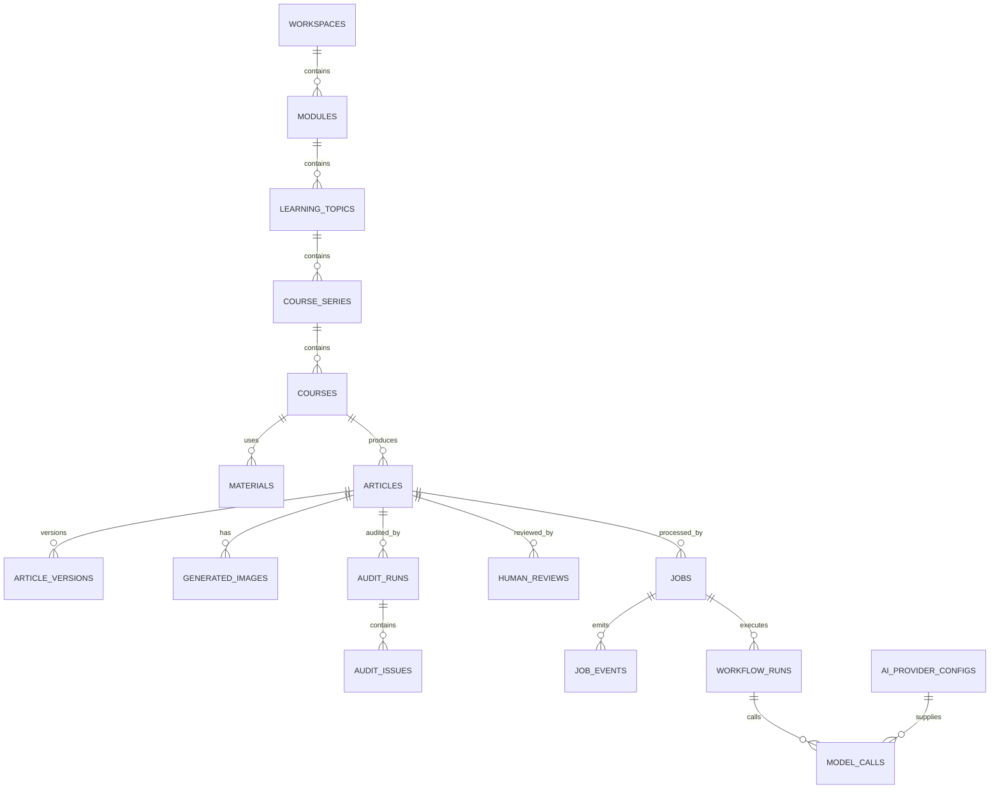

# 数据模型与迁移方案

## 1. 文档状态

- 文档版本：2.4
- 更新日期：2026-07-23
- 目标数据库：SQLite
- ORM：SQLAlchemy 2
- 迁移工具：Alembic
- 工作流恢复：任务租约过期后从固定 LangGraph 起点重跑，暂不启用节点 checkpoint

## 2. 数据存储原则

- SQLite 是业务主数据来源。
- 浏览器 `localStorage` 不再保存 AI 配置、文章正文、版本和人工审核主数据。
- 文件系统保存 Markdown、图片、截图和日志；数据库保存路径、Hash、状态和关联关系。
- API Key 首版允许本机数据库明文保存，但不得写入日志和前端普通接口。
- 所有表使用 UTC 时间，API 返回 ISO 8601。
- 主键使用 UUID 字符串。
- SQLite 开启 WAL 和外键。

## 3. 数据库位置

```text
.chengwenfang/workbench.db
```

数据库旁路文件：

```text
.chengwenfang/workbench.db-wal
.chengwenfang/workbench.db-shm
```

以上文件全部加入 `.gitignore`。

## 4. 核心实体关系



## 5. 核心表

### 5.1 workspaces

| 字段 | 类型 | 说明 |
|---|---|---|
| id | TEXT PK | 工作台 ID |
| name | TEXT | 工作台名称 |
| created_at | DATETIME | 创建时间 |
| updated_at | DATETIME | 更新时间 |

首版只有一条记录。

### 5.2 modules

| 字段 | 类型 | 说明 |
|---|---|---|
| id | TEXT PK | 模块 ID |
| workspace_id | TEXT FK | 所属工作台 |
| slug | TEXT UNIQUE | 模块标识 |
| name | TEXT | 模块名称 |
| status | TEXT | 模块状态 |
| created_at | DATETIME | 创建时间 |
| updated_at | DATETIME | 更新时间 |

首版模块 `learning-content`。

### 5.3 learning_topics

| 字段 | 类型 | 说明 |
|---|---|---|
| id | TEXT PK | 主题 ID |
| module_id | TEXT FK | 所属模块 |
| slug | TEXT UNIQUE | 主题标识 |
| name | TEXT | 主题名称 |
| description | TEXT | 主题说明 |
| route_path | TEXT | 学习路线文件 |
| progress_path | TEXT | 进度文件 |
| created_at | DATETIME | 创建时间 |
| updated_at | DATETIME | 更新时间 |

首批主题 `ai-basics`。

### 5.4 course_series

| 字段 | 类型 | 说明 |
|---|---|---|
| id | TEXT PK | 系列 ID |
| topic_id | TEXT FK | 所属主题 |
| name | TEXT | 系列名称 |
| sort_order | INTEGER | 排序 |
| created_at | DATETIME | 创建时间 |
| updated_at | DATETIME | 更新时间 |

### 5.5 courses

| 字段 | 类型 | 说明 |
|---|---|---|
| id | TEXT PK | 课程 ID |
| series_id | TEXT FK | 所属系列 |
| lesson_no | INTEGER | 课程序号 |
| title | TEXT | 课程标题 |
| summary | TEXT | 摘要 |
| status | TEXT | 生产状态 |
| progress | INTEGER | 0 至 100 |
| current_draft_article_id | TEXT FK NULL | 当前课程原稿 |
| current_wechat_article_id | TEXT FK NULL | 当前公众号文章 |
| created_at | DATETIME | 创建时间 |
| updated_at | DATETIME | 更新时间 |

唯一约束：`series_id + lesson_no`。

### 5.6 materials

| 字段 | 类型 | 说明 |
|---|---|---|
| id | TEXT PK | 素材 ID |
| course_id | TEXT FK | 所属课程 |
| type | TEXT | markdown、pdf、word、video、web、note |
| title | TEXT | 标题 |
| source_path | TEXT | 本地路径或 URL |
| content_text | TEXT NULL | 已提取文本 |
| content_hash | TEXT | 内容 Hash |
| metadata_json | JSON | 元数据 |
| created_at | DATETIME | 创建时间 |
| updated_at | DATETIME | 更新时间 |

### 5.7 articles

统一存储课程原稿和公众号文章。

| 字段 | 类型 | 说明 |
|---|---|---|
| id | TEXT PK | 文章 ID |
| course_id | TEXT FK | 所属课程 |
| kind | TEXT | course_draft、wechat_article |
| title | TEXT | 标题 |
| content | TEXT | 当前 Markdown 正文 |
| file_path | TEXT NULL | 同步文件路径 |
| content_hash | TEXT | 当前内容 Hash |
| word_count | INTEGER | 字数 |
| current_version_no | INTEGER | 当前版本号 |
| status | TEXT | 内容状态 |
| created_at | DATETIME | 创建时间 |
| updated_at | DATETIME | 更新时间 |

唯一约束：`course_id + kind`。

### 5.8 article_versions

| 字段 | 类型 | 说明 |
|---|---|---|
| id | TEXT PK | 版本 ID |
| article_id | TEXT FK | 文章 ID |
| version_no | INTEGER | 版本号 |
| content | TEXT | 完整 Markdown |
| content_hash | TEXT | 内容 Hash |
| source | TEXT | 版本来源 |
| reason | TEXT | 保存原因 |
| audit_run_id | TEXT FK NULL | 关联审核 |
| workflow_run_id | TEXT FK NULL | 关联工作流 |
| created_at | DATETIME | 创建时间 |

`source`：

- `initial_import`
- `manual_edit`
- `ai_generation`
- `ai_repair_before`
- `ai_repair_after`
- `restore`

每篇文章默认保留最近 5 个版本。删除旧版本时不能删除当前版本和人工审核引用版本。

### 5.9 generated_images

| 字段 | 类型 | 说明 |
|---|---|---|
| id | TEXT PK | 图片 ID |
| article_id | TEXT FK | 所属文章 |
| kind | TEXT | cover、inline、test |
| sequence_no | INTEGER NULL | 插图序号 |
| prompt | TEXT | 生图提示词 |
| provider_config_id | TEXT FK | 图片供应商 |
| model | TEXT | 固定 gpt-image-2 |
| size | TEXT | 图片尺寸 |
| quality | TEXT | low、medium、high、auto |
| output_format | TEXT | png、jpeg、webp |
| file_path | TEXT | 文件路径 |
| content_hash | TEXT | 文件 Hash |
| width | INTEGER NULL | 宽度 |
| height | INTEGER NULL | 高度 |
| job_id | TEXT FK | 生成任务 |
| created_at | DATETIME | 创建时间 |

Base64 不存数据库。

### 5.10 ai_provider_configs

| 字段 | 类型 | 说明 |
|---|---|---|
| id | TEXT PK | 配置 ID |
| kind | TEXT UNIQUE | text、image |
| name | TEXT | 供应商名称 |
| model | TEXT | 模型名称 |
| base_url | TEXT | API 根地址 |
| api_key | TEXT | 本机明文 Key |
| protocol | TEXT | 上游协议 |
| timeout_seconds | INTEGER | 超时 |
| max_retries | INTEGER | 重试次数 |
| temperature | REAL NULL | 文本温度 |
| max_output_tokens | INTEGER NULL | 文本输出限制 |
| image_quality | TEXT NULL | 图片质量 |
| enabled | BOOLEAN | 是否启用 |
| created_at | DATETIME | 创建时间 |
| updated_at | DATETIME | 更新时间 |

约束：

- 文本协议：`openai_chat`、`openai_responses`。
- 图片协议：`openai_images`。
- 图片模型：`gpt-image-2`。

### 5.11 audit_runs

| 字段 | 类型 | 说明 |
|---|---|---|
| id | TEXT PK | 审核运行 ID |
| article_id | TEXT FK | 被审核文章 |
| article_version_id | TEXT FK | 被审核版本 |
| type | TEXT | deterministic、semantic、combined、post_repair |
| overall_score | INTEGER | 总分 |
| deterministic_score | INTEGER NULL | 规则分 |
| semantic_score | INTEGER NULL | 语义分 |
| passed_count | INTEGER | 通过数量 |
| warning_count | INTEGER | 警告数量 |
| failed_count | INTEGER | 失败数量 |
| summary | TEXT | 审核摘要 |
| prompt_version | TEXT NULL | AI 审核提示词版本 |
| model_call_id | TEXT FK NULL | 模型调用 |
| created_at | DATETIME | 创建时间 |

### 5.12 audit_issues

| 字段 | 类型 | 说明 |
|---|---|---|
| id | TEXT PK | 问题 ID |
| audit_run_id | TEXT FK | 所属审核 |
| code | TEXT | 稳定规则编码 |
| source | TEXT | deterministic、semantic |
| severity | TEXT | warning、error |
| status | TEXT | pass、warn、fail |
| title | TEXT | 标题 |
| detail | TEXT | 详情 |
| location | TEXT NULL | 章节或位置 |
| suggestion | TEXT NULL | 建议 |
| fixable_by_text_ai | BOOLEAN | 是否可文本修复 |
| blocking | BOOLEAN | 是否阻止人工通过 |
| created_at | DATETIME | 创建时间 |

阶段 4 持久化全部确定性规则结果，而不只保存失败项。这样 `GET /api/audit-runs/{id}` 可以完整恢复前端当次看到的报告。人工审核表仍按计划在阶段 10 创建。

### 5.13 human_reviews

| 字段 | 类型 | 说明 |
|---|---|---|
| id | TEXT PK | 审核 ID |
| article_id | TEXT FK | 文章 ID |
| article_version_id | TEXT FK | 被审核版本 |
| status | TEXT | approved、rejected |
| comment | TEXT | 人工意见 |
| created_at | DATETIME | 审核时间 |
| revoked_at | DATETIME NULL | 撤销时间 |

同一文章只有一条当前未撤销人工审核。

### 5.14 jobs

| 字段 | 类型 | 说明 |
|---|---|---|
| id | TEXT PK | 任务 ID |
| type | TEXT | 任务类型 |
| status | TEXT | pending、running、waiting_human、succeeded、failed、cancelled |
| entity_type | TEXT | course、article、image |
| entity_id | TEXT | 业务对象 ID |
| progress | INTEGER | 0 至 100 |
| current_step | TEXT | 当前步骤 |
| input_json | JSON | 脱敏后的输入 |
| output_json | JSON NULL | 任务输出摘要 |
| error_code | TEXT NULL | 错误编码 |
| error_message | TEXT NULL | 用户可读错误 |
| retry_count | INTEGER | 已重试次数 |
| max_retries | INTEGER | 最大重试 |
| lease_expires_at | DATETIME NULL | worker 租约 |
| created_at | DATETIME | 创建时间 |
| started_at | DATETIME NULL | 开始时间 |
| finished_at | DATETIME NULL | 结束时间 |

### 5.15 job_events

| 字段 | 类型 | 说明 |
|---|---|---|
| id | INTEGER PK | 事件序号 |
| job_id | TEXT FK | 任务 ID |
| event_type | TEXT | started、progress、node、warning、error、completed |
| step | TEXT | 工作流节点 |
| progress | INTEGER | 进度 |
| message | TEXT | 前端展示消息 |
| payload_json | JSON NULL | 事件摘要 |
| created_at | DATETIME | 时间 |

SSE 使用 `id` 作为 `Last-Event-ID`。

### 5.16 workflow_runs

| 字段 | 类型 | 说明 |
|---|---|---|
| id | TEXT PK | 工作流运行 ID |
| job_id | TEXT FK | 所属任务 |
| workflow_name | TEXT | 工作流名称 |
| thread_id | TEXT | LangGraph thread ID |
| status | TEXT | 状态 |
| current_node | TEXT NULL | 当前节点 |
| state_summary_json | JSON | 不含完整正文的状态摘要 |
| created_at | DATETIME | 创建时间 |
| updated_at | DATETIME | 更新时间 |
| finished_at | DATETIME NULL | 完成时间 |

`state_summary_json` 只保存文章 ID、修复记录 ID等脱敏摘要，不保存完整正文。当前通过任务租约重跑实现进程恢复；需要节点级续跑时再增加独立 checkpointer 表。

### 5.17 model_calls

| 字段 | 类型 | 说明 |
|---|---|---|
| id | TEXT PK | 调用 ID |
| workflow_run_id | TEXT NULL | 工作流 ID；阶段 7 创建工作流表后补外键 |
| provider_config_id | TEXT FK NULL | 供应商配置；未保存的连接测试配置可为空 |
| scene | TEXT | 调用场景 |
| model | TEXT | 模型 |
| protocol | TEXT | 协议 |
| prompt_version | TEXT NULL | 提示词版本 |
| input_chars | INTEGER | 输入字符数 |
| output_chars | INTEGER | 输出字符数 |
| input_tokens | INTEGER NULL | 输入 token |
| output_tokens | INTEGER NULL | 输出 token |
| duration_ms | INTEGER | 耗时 |
| retry_count | INTEGER | 重试次数 |
| status | TEXT | succeeded、failed |
| upstream_status | INTEGER NULL | HTTP 状态 |
| upstream_request_id | TEXT NULL | 上游请求 ID |
| error_code | TEXT NULL | 错误编码 |
| created_at | DATETIME | 时间 |

不保存 API Key。是否保存完整提示词和输出正文由本地诊断设置控制，默认不保存。

### 5.18 prompt_versions

| 字段 | 类型 | 说明 |
|---|---|---|
| id | TEXT PK | 提示词版本 ID |
| prompt_key | TEXT | 提示词标识 |
| version | INTEGER | 版本号 |
| scene | TEXT | 使用场景 |
| content_hash | TEXT | 文件 Hash |
| file_path | TEXT | 提示词文件路径 |
| variables_json | TEXT | 模板变量列表 |
| active | BOOLEAN | 是否启用 |
| created_at | DATETIME | 时间 |

### 5.19 repair_runs

| 字段 | 类型 | 说明 |
|---|---|---|
| id | TEXT PK | 修复运行 ID |
| article_id | TEXT FK | 被修复文章 |
| before_version_id | TEXT FK NULL | 修复前备份版本 |
| after_version_id | TEXT FK NULL | 修复后版本 |
| before_audit_run_id | TEXT FK NULL | 修复前审核 |
| after_audit_run_id | TEXT FK NULL | 修复后审核 |
| status | TEXT | running、succeeded、failed、conflict |
| original_content_hash | TEXT | 模型调用前正文 Hash |
| before_score | INTEGER NULL | 修复前分数 |
| after_score | INTEGER NULL | 修复后分数 |
| resolved_codes_json | JSON | 已解决问题编码 |
| added_codes_json | JSON | 新增问题编码 |
| error_code | TEXT NULL | 失败或冲突编码 |
| created_at | DATETIME | 创建时间 |
| finished_at | DATETIME NULL | 完成时间 |
| metadata_json | JSON | 脱敏运行元数据 |

## 6. 文件目录

```text
content/
└── learning-content/
    └── topics/
        └── {topicSlug}/
            ├── route/
            ├── materials/
            ├── drafts/
            ├── wechat/
            └── assets/

.chengwenfang/
├── workbench.db
├── generated-images/
│   └── {articleId}/
├── mdnice-screenshots/
│   └── {articleId}/
└── logs/
    └── {jobId}.jsonl
```

数据库保存相对工作台根目录的路径。读取和写入前必须解析并校验路径仍在允许目录内。

## 7. 当前数据迁移

### 7.1 AI 配置

来源：现有 `ai_provider_configs`。

迁移：

- 保留文本和图片配置。
- 生成 UUID 主键。
- 文本协议映射为 `openai_chat` 或 `openai_responses`。
- 图片协议映射为 `openai_images`。
- 图片模型强制校验为 `gpt-image-2`。
- 增加超时、重试和 enabled 字段。

### 7.2 课程和文章

来源：

- `public/data/chengwenfang-data.json`
- `content/learning-content/topics/ai-basics`

迁移：

- 创建 workspace、module、topic 和 series。
- 根据系列和课程序号创建 courses。
- 课程原稿创建 `course_draft` article。
- 公众号文章创建 `wechat_article` article。
- 当前 Markdown 作为 `initial_import` 版本。
- 计算内容 Hash 和字数。

### 7.3 图片

- 扫描现有图片路径。
- 计算 Hash、尺寸和格式。
- 建立 article 关联。
- 无法确定所属文章的图片记录为 orphan，等待人工处理。

### 7.4 浏览器本地数据

当前浏览器中可能存在：

- 编辑后的文章。
- 人工审核记录。
- 文章版本。

由于后端无法直接读取浏览器 localStorage，迁移阶段需要临时前端接口：

1. 前端启动时读取旧键。
2. 调用一次性 `/api/migrations/browser-state`。
3. 后端写入数据库。
4. 返回迁移成功记录。
5. 前端删除旧键。
6. 该接口只在迁移版本中保留。

## 8. Alembic 迁移顺序

1. `0001_ai_provider_configs`（已完成）
2. `0002_core_content_tables`（已完成，包含课程、文章和文章版本）
3. `0003_audit_and_human_review`（已完成审核表，人工审核表留到阶段 10）
4. `0004_langchain_model_layer`（已完成，包含 `model_calls` 和 `prompt_versions`）
5. `0005_article_repair_workflow`（已完成，包含 `repair_runs`）
6. `0006_background_jobs_and_sse`（已完成，包含 jobs、job_events、workflow_runs）
7. `0007_generated_images`（已完成，包含图片元数据；二进制保存在 `.chengwenfang/generated-images`）
8. `0008_mdnice_exports`（已完成，保存 Markdown hash、主题、截图相对路径、尺寸和脱敏错误）
9. `0009_human_reviews`（已完成，人工审核绑定文章版本；内容变化后旧决定自动失效）
10. 后续迁移按生产化需求连续编号

现有内容导入由启动期幂等导入服务执行，不作为一次性 Alembic revision；这样新增课程可以在后续启动时补充导入，同时不会覆盖数据库编辑稿。

数据导入不应全部写在 Alembic SQL 中。结构迁移使用 Alembic，复杂内容导入使用独立 migration command，并记录导入批次。

## 9. 事务设计

### 9.1 AI 修复

模型调用在事务外。

返回内容通过校验后，一个事务中完成：

1. 锁定当前文章记录。
2. 检查文章 Hash 是否仍等于模型调用前 Hash。
3. 保存 `ai_repair_before` 版本。
4. 替换当前正文。
5. 保存 `ai_repair_after` 版本。
6. 更新 current version、Hash 和时间。
7. 创建 `post_repair` 审核任务。
8. 提交。

Hash 不一致说明用户在 AI 调用期间修改了文章，此时拒绝覆盖并提示重新执行修复。

### 9.2 版本恢复

1. 保存当前内容为 `restore` 前备份。
2. 将目标版本内容写入当前文章。
3. 生成新的版本号，不直接把 current_version_no 指向旧记录。
4. 创建重新审核任务。

### 9.3 人工审核

人工审核必须绑定文章版本。如果文章内容变化，旧人工通过状态自动失效，但历史记录保留。

## 10. 索引

建议索引：

- `courses(series_id, lesson_no)`
- `articles(course_id, kind)`
- `article_versions(article_id, version_no DESC)`
- `audit_runs(article_id, created_at DESC)`
- `audit_issues(audit_run_id, severity)`
- `human_reviews(article_id, revoked_at)`
- `jobs(status, created_at)`
- `job_events(job_id, id)`
- `workflow_runs(job_id)`
- `model_calls(workflow_run_id, created_at)`
- `generated_images(article_id, kind, sequence_no)`

## 11. 数据保留

- 文章版本：默认最近 5 个，人工审核引用版本不自动删除。
- 审核报告：全部保留。
- 人工审核：全部保留。
- 任务和事件：默认保留 90 天，失败任务至少保留 30 天。
- 模型调用元数据：默认保留 90 天。
- 测试图片：默认保留 7 天，可手动清理。
- 正式图片和 mdnice 截图：持续保留。

## 12. 备份

提供本地备份命令：

- 使用 SQLite backup API 复制数据库。
- 复制 `content/` 和 `.chengwenfang/generated-images/`。
- 备份前执行 WAL checkpoint。
- 不复制临时日志和测试图片，除非显式指定。

## 13. 验收

- 服务重启后 AI 配置仍存在。
- 所有文章都有初始版本。
- AI 修复成功后有 before 和 after 两个版本。
- AI 修复失败时文章 Hash 和版本数不变。
- 版本恢复会产生新版本并重新审核。
- 人工审核绑定具体文章版本。
- 浏览器旧数据迁移后不再作为主数据使用。
- 数据库迁移可在空库和现有库上重复验证。
