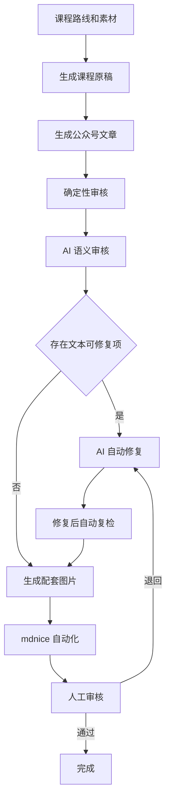
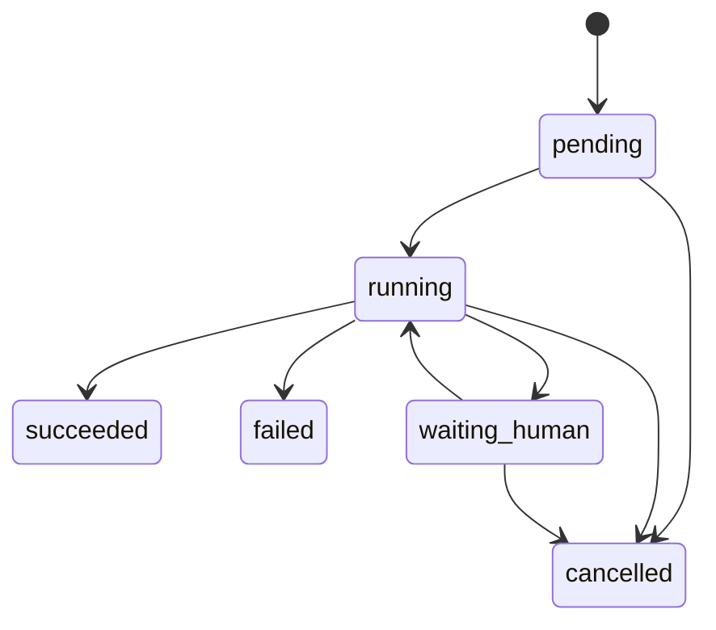
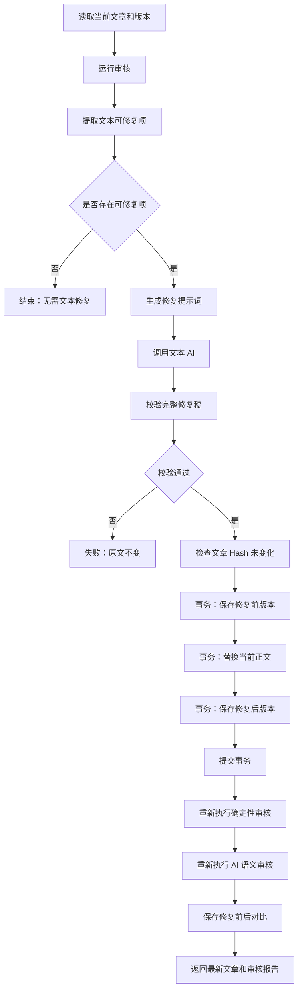
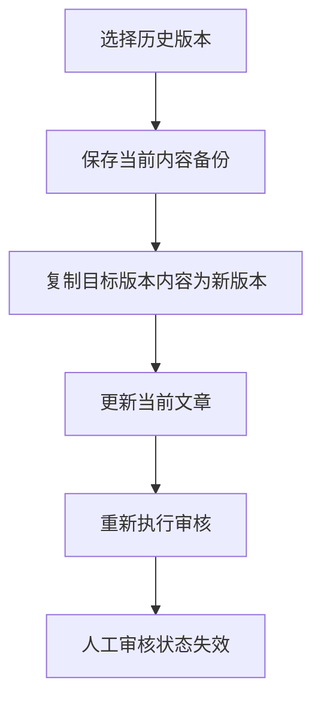

# 生成、审核与修复流程设计

## 1. 文档状态

- 文档版本：2.5
- 更新日期：2026-07-23
- 编排技术：LangGraph
- 模型调用：LangChain 文本模型层 + OpenAI Python SDK Image API
- 任务执行：数据库任务表 + 本地单 worker
- 人工审核：首轮重构使用普通数据库状态流转

## 2. 总流程



每个耗时步骤创建 `job` 和 `workflow_run`。前端通过 SSE 查看进度。

## 3. 通用任务生命周期



任务事件至少包括：

- 已创建。
- 已读取输入。
- 开始调用模型。
- 模型调用完成。
- 正在校验输出。
- 正在写入数据库。
- 正在重新审核。
- 完成或失败。

## 4. 课程原稿生成

### 4.1 输入

- 学习路线。
- 课程标题和目标。
- 当前课程素材。
- 同系列历史课程样例。
- 插图风格指南。
- 课程原稿提示词版本。

### 4.2 LangGraph 节点

1. `load_course_context`
2. `load_materials`
3. `select_reference_articles`
4. `build_draft_prompt`
5. `call_text_model`
6. `validate_draft`
7. `save_draft_transaction`
8. `run_deterministic_audit`
9. `complete_job`

### 4.3 输出校验

- 输出不是空字符串。
- 输出不是错误 HTML。
- 输出不包含外层代码围栏。
- 字数达到课程最低要求。
- 包含本课小结。
- 包含下节课预告。
- 小结在预告之前。
- 内容 Hash 与输入样例不同。

### 4.4 保存

事务中：

- 创建或更新 `course_draft` article。
- 保存旧内容版本。
- 保存新版本。
- 更新课程状态。
- 创建审核记录。

## 5. 公众号文章生成

### 5.1 输入

- 当前课程原稿版本。
- 公众号排版规范。
- 文章样例。
- 封面和插图规则。
- 公众号提示词版本。

### 5.2 LangGraph 节点

1. `load_course_draft`
2. `load_wechat_rules`
3. `build_wechat_prompt`
4. `call_text_model`
5. `validate_article`
6. `save_article_transaction`
7. `run_combined_audit`
8. `complete_job`

### 5.3 生成约束

- 不压缩原稿核心内容。
- 不改变具体含义。
- 标题去掉课程编号。
- 重点概念可使用粗体。
- 表格按规范转为列表。
- 不使用 triple-backtick code fence。
- 生成封面提示词和正文插图提示词。
- 小结位于预告之前。

## 6. 图片生成

### 6.1 技术路径

图片生成不经过 LangChain Agent，直接调用 OpenAI Python SDK：

```python
result = client.images.generate(
    model="gpt-image-2",
    prompt=prompt,
    n=1,
    size=size,
    quality=quality,
    output_format="png",
)
```

上游接口：

```text
POST {base_url}/images/generations
```

正式图片通过 `image_generation` 任务进入独立 worker 的固定 LangGraph；生成成功后先完成 PNG、尺寸、Hash 和工作目录校验，再保存图片记录。只有请求携带明确占位符且占位符存在时，才创建文章新版本并替换引用。

### 6.2 图片类型

- 封面图 1 张。
- 正文插图 3 至 5 张。
- 配置测试图。

### 6.3 LangGraph 节点

1. `load_image_prompts`
2. `normalize_image_prompt`
3. `create_image_jobs`
4. `call_image_api`
5. `decode_image`
6. `validate_image`
7. `save_image_file`
8. `save_image_record`
9. `replace_article_placeholders`
10. `complete_job`

### 6.4 图片校验

- 响应包含 `data[0].b64_json` 或兼容 URL。
- Base64 可解码。
- 文件格式和扩展名一致。
- 图片尺寸符合要求。
- 文件 Hash 不为空。
- 文件位于工作台允许目录内。
- Windows 文件路径中的文章 ID 会先归一化为安全目录名，数据库仍保留原始文章关联。

### 6.5 失败处理

- 图片生成超时默认 180 秒。
- 429、502、503 和连接重置最多重试 2 次。
- 重试使用指数退避。
- 正式图片失败不替换文章占位符。
- 测试连接失败不写正式图片表，可写测试任务记录。

## 7. 确定性审核

实施状态：阶段 4 已完成。确定性审核由 FastAPI 调用 Python 规则引擎执行，审核绑定当前文章版本，并将报告及全部规则结果持久化到 SQLite。AI 语义审核仍在后续阶段实现。

### 7.1 规则分类

#### 文本 AI 可修复

- 开头摘要不完整。
- 正文出现禁用符号。
- 存在代码围栏。
- 小结和预告顺序错误。
- 缺少文章图片引用，但已有可用图片资产。

#### 流程或资产处理

- 文章不存在。
- 图片文件不存在。
- 图片元数据不完整。
- mdnice 截图不存在。
- 图片生成任务失败。
- 当前版本没有保存。

### 7.2 禁用符号检查

规则检查正文可见文本，不检查：

- Markdown 链接目标。
- Markdown 图片 URL。
- 自动链接中的 `https://`。
- 代码中的技术 URL，前提是该代码片段允许存在。

### 7.3 输出

每条问题包含：

```json
{
  "code": "FORBIDDEN_SYMBOL",
  "severity": "error",
  "title": "正文禁用符号检查",
  "detail": "发现长破折号",
  "location": "第四层：行动",
  "suggestion": "改为逗号或句号",
  "fixableByTextAi": true,
  "blocking": true
}
```

## 8. AI 语义审核

实施状态：阶段 5 已完成 LangChain 模型工厂、提示词版本、模型调用记录和 Pydantic 结构化输出基础设施；正式语义审核工作流在后续阶段接入。

### 8.1 输入

- 当前课程原稿。
- 当前公众号文章。
- 课程目标。
- 确定性审核摘要。
- 语义审核提示词版本。

### 8.2 检查项

- 是否改变原稿含义。
- 是否遗漏关键概念。
- 是否引入无法从原稿支持的事实。
- 是否有明显重复或逻辑断裂。
- 标题、摘要和正文是否一致。
- 是否适合目标读者。

### 8.3 结构化输出

使用 Pydantic 结构化模型。解析失败不能保存为正式审核。

### 8.4 评分

建议：

```text
overall = deterministic_score × 0.6 + semantic_score × 0.4
```

存在 blocking error 时，即使分数较高也不能人工通过。

## 9. AI 自动修复

实施状态：阶段 6 已完成。修复提示词、文本模型调用、完整稿校验、并发 Hash 检查、前后版本、确定性复检和问题差异均由后端 LangGraph 固定节点完成。正式 AI 语义复检仍待后续语义审核工作流接入。

### 9.1 固定业务顺序



### 9.2 提示词内容

提示词只包含文本 AI 可修复问题：

- 问题编码。
- 严重程度。
- 问题说明。
- 建议。
- 课程信息。
- 完整当前文章。
- 必须保留的图片引用。
- 输出完整 Markdown 的要求。

提示词不包含：

- API Key。
- 本地绝对路径。
- 图片 Base64。
- 结构化图片资产数据库问题。
- mdnice 自动化问题。

### 9.3 AI 返回校验

- 非空。
- 不是 HTML 错误页。
- 清除外层 Markdown 代码围栏。
- 与原文不完全相同。
- 长度没有异常下降。
- 保留关键标题和图片引用。
- 未被明显截断。
- 可以通过 Markdown 基础解析。

### 9.4 版本和并发

模型调用前保存：

- 当前 article ID。
- 当前 version no。
- 当前 content hash。

模型返回后，如果数据库当前 Hash 已变化，说明用户在模型运行期间编辑了文章：

- 不覆盖新内容。
- 任务标记为 conflict。
- 提示用户重新执行修复。

### 9.5 自动复检

替换成功后必须重新执行全部审核，不沿用旧报告。

保存：

- 修复前 audit run。
- 修复后 audit run。
- 分数变化。
- 失败项变化。
- 警告项变化。
- 已解决问题编码。
- 新增问题编码。

### 9.6 失败分支

以下情况原文保持不变：

- 上游 4xx 或 5xx。
- Cloudflare 502 HTML。
- 超时。
- 结构化输出错误。
- 返回空内容。
- 返回内容与原文相同。
- 返回内容被截断。
- 内容 Hash 冲突。
- 数据库事务失败。

前端只显示简短错误，不显示上游 HTML。

## 10. 人工审核

### 10.1 页面数据

- 当前文章版本。
- 图片预览。
- mdnice 截图。
- 最新确定性审核。
- 最新 AI 语义审核。
- 修复前后对比。
- 版本历史。

### 10.2 操作

- 通过。
- 退回。
- 填写意见。
- 撤销决定。
- 恢复历史版本。
- 重新审核。
- 重新生成图片。
- 重新执行 mdnice。

### 10.3 状态约束

- 存在 blocking error 时不能通过。
- 退回必须填写意见。
- 人工审核绑定具体文章版本。
- 内容变化后旧人工通过自动失效。
- 恢复版本后必须重新审核。

## 11. 版本恢复



历史版本记录不可直接修改。

## 12. mdnice 自动化

实现状态：阶段 9 已完成。后端通过 `POST /api/articles/{article_id}/mdnice/exports` 创建持久化任务，单 worker 使用 Playwright 打开 mdnice、写入 Markdown、选择主题并保存 PNG；截图通过 `/api/mdnice/exports/{export_id}/screenshot` 安全读取，任务进度沿用 SSE。

### 12.1 输入

- 当前公众号文章版本。
- 已替换图片路径的 Markdown。
- mdnice URL。
- 主题选择规则。

### 12.2 节点

1. `launch_browser`
2. `open_mdnice`
3. `wait_editor_ready`
4. `replace_editor_content`
5. `select_my_theme`
6. `wait_preview`
7. `capture_screenshot`
8. `save_result`
9. `close_browser`

### 12.3 失败记录

- 当前步骤。
- 错误消息。
- 页面截图。
- 控制台日志。
- Playwright trace，可通过诊断设置启用。

## 13. SSE 进度事件

示例：

```text
id: 14
event: progress
data: {"step":"call_text_model","progress":40,"message":"正在调用文本 AI"}

id: 15
event: progress
data: {"step":"commit_repair_transaction","progress":70,"message":"正在保存原文版本并替换文章"}

id: 16
event: completed
data: {"progress":100,"message":"修复和自动复检完成"}
```

前端断线后使用 `Last-Event-ID` 继续读取。

当前 AI 修复请求先返回 `202 Accepted` 和任务 ID。worker 串行执行固定修复图，节点进度与任务状态在同一数据库中持久化；前端收到 `completed` 后再读取修复结果，收到 `error` 时只展示脱敏后的用户可读消息。

## 14. 重试策略

### 文本 AI

- 默认超时 30 秒，可在配置中调整。
- 429、502、503、连接重置重试 2 次。
- 4xx 参数错误不自动重试。
- Cloudflare HTML 归一化为 `UPSTREAM_BAD_GATEWAY`。

### 图片 AI

- 默认超时 180 秒。
- 429、502、503、连接重置重试 2 次。
- 同一任务重试使用相同提示词和参数。

### mdnice

- 页面加载和主题选择各重试 1 次。
- 内容写入后必须校验编辑器文本长度。

## 15. 测试方案

### 15.1 审核规则测试

- URL 不触发 `//` 误报。
- 长破折号能正确定位。
- 小结和预告顺序正确判断。
- 图片资产问题标记为不可文本修复。

### 15.2 修复工作流测试

- AI 502 时原文和版本数不变。
- AI 返回空内容时原文不变。
- AI 返回相同内容时原文不变。
- AI 成功时先有 before 版本，再有 after 版本。
- 修复后产生全新审核报告。
- 用户并发编辑时触发 Hash conflict。
- 数据库提交失败时完整回滚。

### 15.3 图片测试

- 使用 `/images/generations`。
- 固定模型 `gpt-image-2`。
- 可解码 `b64_json`。
- 180 秒内完成或返回可读超时。

### 15.4 前端回归

- 页面布局和样式不变。
- 长错误信息不会撑宽审核面板。
- SSE 断线可重连。
- 修复前后分数和问题变化正确展示。
