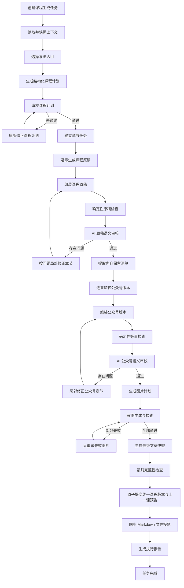

# Codex 式分步生成工作流改造方案

## 1. 文档定位

本文档是在《06-知识库一致性生成流程改造方案》基础上的工程化深化方案，重点解决以下问题：

1. 工作台虽然展示了多个执行步骤，但课程原稿仍依赖一次超长文本模型请求。
2. 上游长流式响应失败时，整条生成链路中断，配置的重试不一定生效。
3. 当前“重新执行失败步骤”会重新创建整条课程生成任务，不是真正的节点级续跑。
4. 中间计划、章节草稿、审校问题和修正结果没有作为可恢复产物持久化。
5. 执行轨迹能够展示进度事件，但不足以还原每个节点的真实输入、输出和重试过程。
6. 工作台与知识库使用了相近的规则和 Skill，但执行方式仍与 Codex Agent 有明显差异。

本方案的目标不是在工作台中直接嵌入 Codex 桌面运行时，而是实现与 Codex 高度一致的工作方法：

> 分步读取 → 形成计划 → 分节写作 → 持久化中间结果 → 确定性检查 → AI 语义审校 → 局部修正 → 分步生成公众号版本和图片 → 最终原子提交。

## 2. 现状证据与根因

### 2.1 Codex 生成知识库课程的实际方式

根据模型原理第 3 课执行报告，Codex 的正文生成过程具有以下特点：

- 先读取学习路线、相邻课程、写作规则、公众号规范和图片规范。
- 在 Agent 会话中逐步形成课程边界、文章结构和最终正文。
- 生成后继续执行术语、计算、格式、图片引用和课程衔接检查。
- 文件读取或检查失败时会切换处理方式，不会重做已经成功的正文。
- 课程正文由 Codex 当前 Agent 直接生成，并未通过工作台配置的文本 AI 网关。
- 外部模型 API 只用于图片生成，且每张图片独立调用和检查。

### 2.2 工作台当前实际方式

当前课程原稿生成会将以下内容合并为一次请求：

- 写作规范和系统 Skill。
- 生成课程内容场景 Skill。
- 完整课程路线。
- 上一课正文片段。
- 当前课程已有正文片段。
- 课程边界计划。
- 当前课程标题和摘要。

模型原理第 2 课最近一次失败请求的实际数据为：

| 指标 | 实际值 |
| --- | --- |
| 场景 | `course-draft-generation` |
| 协议 | `openai_responses` |
| 输入字符数 | 23,884 |
| 输出字符数 | 0 |
| 耗时 | 68,452ms |
| HTTP 状态码 | 无 |
| 上游请求 ID | 无 |
| 重试次数 | 0 |
| 错误码 | `UPSTREAM_INVALID_RESPONSE` |

该错误发生在课程原稿内容返回之前，因此没有进入原稿完整性检查、公众号生成或图片生成。

### 2.3 为什么连接测试成功但正式生成失败

当前连接测试只要求模型返回极短文本，只能证明以下事项：

- API Key 可用。
- Base URL 可以连接。
- 模型名称被上游接受。
- 一个简单 Responses 请求可以成功。

它不能证明：

- 20,000 字符以上输入能够稳定处理。
- 10,000 字符以上输出能够完整流式返回。
- 网关实现了全部 Responses 流式事件。
- 长连接不会被代理、网关或中间网络提前关闭。
- LangChain 和 OpenAI SDK 能识别网关返回的所有事件变体。

### 2.4 当前重试为什么没有生效

文本客户端只将连接错误、超时、HTTP 错误和部分 HTTP 状态码识别为可重试错误。流式 JSON 解码、事件结构校验、消息块拼接等未分类异常会直接包装成 `UPSTREAM_INVALID_RESPONSE`，但不会进入重试分支。

因此，即使配置了 `maxRetries = 2`，本次请求的实际重试次数仍为 0。

### 2.5 核心结论

当前失败不是课程知识、文章格式或图片内容不合格，而是超长单次文本请求的传输和协议解析失败。继续增加提示词、延长固定超时或让用户反复点击重试，无法从根本上解决问题。

## 3. 改造目标与非目标

### 3.1 必须达到的目标

1. 每个执行步骤都是真实、独立、可持久化的工作流节点。
2. 课程原稿按章节生成，不再依赖一次超长输出。
3. 任意节点失败后可以从该节点继续，不重复已完成节点。
4. 中间产物可查看、可审计，但不产生正式文章版本。
5. 确定性规则先检查，AI 只处理语义判断和局部修正。
6. 公众号版本以审校通过的课程原稿为唯一事实来源。
7. 每张图片独立生成、检查和重试。
8. 只有全部硬性检查通过后，才原子提交正式课程版本。
9. 工作台运行时不依赖外部知识库目录，规则通过内置快照同步。
10. 用户仍然只点击一次“生成课程内容”。

### 3.2 非目标

- 不直接调用 Codex CLI 或 Codex 桌面内部会话。
- 不让文本模型直接执行任意 SQL、文件删除或版本提交。
- 不把所有后端控制逻辑交给自由 Agent 决策。
- 不为了模拟 Codex 而取消现有数据库、任务队列和版本体系。
- 不在本阶段引入 Redis、Celery 或多机调度。

## 4. 总体设计原则

### 4.1 受控 Agent，而不是完全自由 Agent

AI 负责：

- 判断适用的系统 Skill。
- 设计课程计划和章节结构。
- 分章节生成课程内容。
- 执行语义审校。
- 根据明确问题局部修正。
- 将原稿等量转换为公众号版本。
- 规划图片提示词。

后端负责：

- 节点顺序、状态和重试上限。
- 上下文预算和输入裁剪。
- 数据库、文件和版本事务。
- 确定性规则检查。
- 并发控制和幂等性。
- 错误分类、降级和恢复。
- 对用户展示真实执行轨迹。

这样既保留 Codex 的推理和局部返工能力，又避免模型对持久化系统产生不可控副作用。

### 4.2 中间产物与正式版本分离

课程计划、章节草稿、审校报告、修正稿、内容清单和图片计划全部属于工作流中间产物。它们可以保存到数据库用于恢复和查看，但不能直接写入正式文章表，也不能增加用户可见版本号。

### 4.3 每个节点必须幂等

同一节点使用相同输入 Hash 再次执行时：

- 已有成功产物则直接复用。
- 输入发生变化才创建新的节点尝试。
- 文件写入使用临时文件加原子重命名。
- 数据库提交通过唯一键防止重复。

### 4.4 先便宜检查，再调用 AI

检查顺序固定为：

1. 结构和格式检查。
2. 数量、引用、标题和禁用符号检查。
3. 公式、数值和清单对照。
4. AI 语义审校。

确定性检查已能发现的问题不再消耗额外模型调用。

## 5. 目标工作流



## 6. 节点详细设计

### 6.1 `snapshot_context`：读取并快照上下文

读取内容：

- 当前学习主题和系列。
- 当前系列完整课程路线。
- 当前课程标题、摘要和位置。
- 上一课与下一课元数据。
- 上一课原稿和公众号版本。
- 当前课程现有原稿和公众号版本。
- 知识库规则快照。
- Skill 名称、简介、类型、顺序、状态、版本和内容 Hash。

输出产物：`context_snapshot`。

可能问题与方案：

| 问题 | 处理方案 |
| --- | --- |
| 路线中课程不存在 | 立即失败，错误码 `ROUTE_COURSE_NOT_FOUND` |
| 上一课正文不存在 | 记录缺失，不阻止生成；使用路线摘要作为衔接上下文 |
| 下一课不存在 | 按系列末课规则生成收束预告 |
| 规则文件缺失 | 使用数据库中的内置规则快照，并在报告中记录来源 |
| 用户生成过程中手动修改文章 | 保存基线内容 Hash，最终提交前再次比较并触发冲突处理 |
| 上下文太长 | 快照完整保存，但进入模型前按节点构建最小上下文 |

### 6.2 `select_system_skills`：选择系统 Skill

系统 Skill 不设固定顺序。该节点先向模型提供系统 Skill 的名称和简介，让模型返回本次实际需要的 Skill ID；再由后端加载所选 Skill 的完整内容。

场景 Skill 仍按配置顺序强制执行。

效率约束：

- 系统 Skill 默认最多选择 3 个。
- 相同规则只保留一个规范来源。
- Skill 内容按 Hash 快照，任务开始后不受配置修改影响。
- 系统 Skill 选择结果必须记录理由，但不要求保存模型内部推理过程。

可能问题：模型漏选必需 Skill。

解决方案：将安全、版本和数据完整性规则保留为后端硬规则，不依赖模型选择；课程审校、图片规范等业务 Skill 可由模型选择。

### 6.3 `plan_course`：生成结构化课程计划

输入仅包括：

- 课程路线和相邻课程摘要。
- 当前课程已有内容摘要。
- 适用 Skill。
- 写作规范。

模型必须返回结构化 `CourseGenerationPlan`：

```json
{
  "courseGoal": "",
  "mustCover": [],
  "mustNotCover": [],
  "requiredTerms": [],
  "requiredFormulas": [],
  "requiredExamples": [],
  "previousConnection": "",
  "nextConnection": "",
  "sections": [
    {
      "key": "opening",
      "title": "",
      "goal": "",
      "mustCover": [],
      "targetChars": 800,
      "dependsOn": []
    }
  ],
  "imageIntents": []
}
```

计划审校使用 Pydantic 结构校验和确定性边界检查。缺少课程目标、必须知识点、章节或课程衔接时不允许进入正文生成。

计划最多修正 2 次。结构化输出解析失败时先进行一次格式修复，再重新调用模型，不能用字符串截取拼出伪 JSON。

### 6.4 `generate_draft_sections`：分章节生成原稿

每个章节是独立节点实例，标识为 `draft_section:{section_key}`。

单章节模型输入包括：

- 课程总计划的精简版本。
- 当前章节计划。
- 必须遵守的规则和适用 Skill。
- 上一章节正文或不超过 1,200 字的摘要。
- 当前章节必须使用的公式、案例和术语。
- 下一章节目标摘要，用于控制收束。

单次输出目标建议控制在 800 至 2,500 个中文字符。具体长度由章节计划决定，不使用所有章节相同的固定长度。

生成顺序默认串行，因为章节之间需要连续表达。只有没有前后依赖的附录类章节才允许并行。

可能问题与方案：

| 问题 | 处理方案 |
| --- | --- |
| 章节输出为空 | 执行传输重试，仍为空则失败该章节 |
| 输出要求用户提供素材 | 按明确标记拒绝，并以“路线自主生成”提示局部重试 |
| 重复上一章 | 使用文本相似度和重复段落检查，要求重写当前章节 |
| 提前展开下一课 | 对照 `mustNotCover` 检查并局部修正 |
| 公式缺失 | 只修正当前章节，不重写整篇 |
| 单章过长 | 由章节计划拆成子章节，保存新的动态节点实例 |
| 上游持续失败 | 保留其他成功章节，任务停在当前章节等待重试 |

### 6.5 `assemble_draft`：组装课程原稿

后端按章节计划顺序组装，不允许模型重新生成整篇。

组装时统一处理：

- 主标题只保留一个。
- 本课目标位置固定。
- 图片引用、插图位置和提示词块格式统一。
- 本课小结位于下节课预告之前。
- 章节之间只做空行和标题级别规范化，不擅自改写正文。

### 6.6 `review_draft`：原稿双层审校

第一层为确定性检查：

- 结构完整性。
- 必须知识点和术语出现情况。
- 必须公式、数值和案例存在性。
- 禁用符号。
- 图片引用和提示词配对。
- 小结与预告顺序。
- 与下一课边界的关键词检查。

第二层为 AI 语义审校：

- 知识准确性。
- 公式解释是否正确。
- 数值案例推导是否连贯。
- 零基础可读性。
- 前后课程衔接。
- 作者声音和自然表达。
- 是否出现隐性越界或知识缺口。

AI 只返回结构化问题列表，不直接返回整篇新文章：

```json
{
  "status": "needs_revision",
  "issues": [
    {
      "code": "TERM_NOT_EXPLAINED",
      "severity": "blocking",
      "sectionKey": "relu",
      "evidence": "",
      "expected": "",
      "repairInstruction": ""
    }
  ]
}
```

### 6.7 `repair_draft_sections`：按问题局部修正

每次只向模型提供：

- 存在问题的章节。
- 与问题直接相关的规则。
- 审校证据和修正要求。
- 必须保持不变的公式、案例和图片引用。

修正后重新执行章节检查和整篇检查。最多 3 轮；第三轮仍有阻断问题时停止自动处理并保留所有中间产物。

禁止将局部问题升级为全文重写，除非课程计划本身被判定错误并明确回退到 `plan_course`。

### 6.8 `extract_manifest`：提取内容保留清单

内容清单必须包含：

- 章节和关键结论。
- 专业术语及解释。
- 公式原文和含义。
- 数值案例的输入、步骤和结果。
- 重要限定语和边界条件。
- 图片引用和文章位置。
- 本课小结和下节课预告。

确定性解析能够提取的内容由代码处理；难以结构化的关键结论由模型补充。最终清单经过 Schema 校验后保存。

### 6.9 `generate_wechat_sections`：分章节转换公众号版本

公众号版本不重新从路线创作，而是逐章转换已经审校通过的原稿。

每个公众号章节输入包括：

- 对应课程原稿章节。
- 内容保留清单中与该章节相关的条目。
- 公众号排版规范。
- 全文标题和章节编号规则。

第一章负责生成公众号标题、摘要和开场，其余章节不得新增主标题。转换后由后端按顺序组装。

公众号转换不依赖超长全文请求。必要时可以为标题和摘要单独调用一次小模型请求。

### 6.10 `review_wechat`：公众号等量检查

必须检查：

- 每个清单条目均有对应内容。
- 公式、数值和案例结论未改变。
- 图片引用数量、顺序和位置一致。
- 不残留插图位置说明和提示词。
- 不保留课程编号、Markdown 表格和代码围栏。
- 不提前展开下一课。

差异必须定位到具体章节和清单项，修正时只处理缺失或错误章节。

### 6.11 `plan_images`：建立图片计划

图片计划以原稿中的提示词和课程计划中的图片意图为来源。后端对语义相同的图片做去重，但不能仅按字符串相等判断。

每张图片包含：

- 稳定图片 ID。
- 封面或正文类型。
- 文章位置。
- 主要结论。
- 完整提示词。
- 目标尺寸和质量。
- 原稿占位符。
- 公众号替换位置。

封面固定 `2400x1024`，正文图固定 `2048x1152`，模型固定使用图片配置中的 `gpt-image-2`。

### 6.12 `generate_images`：逐图生成和检查

图片是独立节点实例，标识为 `image:{image_id}`。建议并发数为 2，避免同时请求过多导致限流。

每张图生成后立即执行：

- 文件存在和 PNG 解码检查。
- 实际尺寸和宽高比检查。
- 内容 Hash 和文件路径记录。
- 文章引用可解析检查。
- 可选的视觉语义检查。

图片尺寸与请求不一致时：

- 比例错误或低于最低尺寸：重新生成。
- 比例正确但供应商返回固定近似尺寸：记录实际尺寸，按配置决定是否规范化。
- 不允许无记录地拉伸图片。

图片失败只重试当前图片，其他成功图片继续保留。

### 6.13 `prepare_final_snapshot`：准备最终快照

该节点在中间产物中完成：

- 课程原稿保留提示词，并在提示词下方插入图片。
- 公众号版本删除提示词，将原位置替换为图片引用。
- 生成统一版本说明、文件差异和内容统计。
- 生成上一课预告的精确替换补丁。

此时仍不修改正式文章。

### 6.14 `commit_course_version`：原子提交

提交前重新读取当前原稿、公众号和上一课内容 Hash。

如果任何基线内容已被用户修改：

- 停止提交并标记 `CONTENT_CONFLICT`。
- 不覆盖用户内容。
- 保留生成结果供用户查看。
- 后续可提供“基于最新内容重新合并”，但不自动执行三方合并。

无冲突时，在同一数据库事务中：

1. 创建统一课程版本号。
2. 写入课程原稿。
3. 写入公众号版本。
4. 写入图片引用和资产关联。
5. 精确更新上一课预告。
6. 关联工作流、版本和模型调用记录。

数据库是工作台的正式内容主存储。Markdown 文件属于可恢复投影，不能宣称数据库事务与 Windows 文件替换具有跨介质原子性。

提交协议为：

1. 在正式数据库事务中写入文章、统一版本、上一课预告、图片关联和 `file_projection_outbox` 记录。
2. 数据库提交成功后，文件投影 worker 根据 outbox 内容写临时文件并原子重命名。
3. 文件 Hash 与数据库目标 Hash 一致后，将 outbox 标记为完成。
4. 进程在文件同步期间中断时，worker 根据未完成 outbox 自动补写，不重复创建课程版本。
5. 文件同步持续失败时，任务状态显示“内容已保存，文件同步待恢复”，不能把已提交版本伪装成完全失败。

数据库事务失败时全部回滚。图片文件已提前生成的，保留为未关联资产并由后续清理任务处理，不在异常处理中直接删除。

## 7. 持久化模型设计

### 7.1 复用现有表

继续使用：

- `jobs`：用户可见的总体任务状态。
- `job_events`：SSE 和执行轨迹事件。
- `workflow_runs`：一次课程生成的总体工作流。
- `model_calls`：脱敏模型调用元数据。
- 文章、文章版本、图片资产和 Skill 表。

### 7.2 新增 `workflow_node_runs`

建议字段：

| 字段 | 用途 |
| --- | --- |
| `id` | 节点尝试 ID |
| `workflow_run_id` | 所属工作流 |
| `node_key` | 节点类型，如 `draft_section` |
| `instance_key` | 实例，如 `relu` 或图片 ID |
| `attempt_no` | 当前节点第几次尝试 |
| `status` | pending/running/completed/failed/retrying/skipped |
| `input_hash` | 节点输入 Hash |
| `output_artifact_id` | 成功产物 |
| `error_code` | 稳定错误码 |
| `error_category` | transport/protocol/content/validation/conflict/system |
| `error_message` | 用户可见错误 |
| `retryable` | 是否允许自动重试 |
| `started_at` | 开始时间 |
| `finished_at` | 结束时间 |

唯一约束建议为：

`workflow_run_id + node_key + instance_key + attempt_no`。

### 7.3 新增 `workflow_artifacts`

统一保存中间产物，避免为每一种产物建立独立表。

| 字段 | 用途 |
| --- | --- |
| `id` | 产物 ID |
| `workflow_run_id` | 所属工作流 |
| `kind` | context_snapshot/course_plan/draft_section/draft_assembled/audit/manifest/wechat_section/image_plan/final_snapshot/report |
| `scope_key` | 章节或图片实例标识 |
| `content_text` | Markdown 等文本内容 |
| `content_json` | 结构化产物 |
| `content_hash` | 内容 Hash |
| `source_node_run_id` | 产生该产物的节点 |
| `supersedes_id` | 修正前产物 |
| `created_at` | 创建时间 |

规则：`content_text` 与 `content_json` 至少一个有值；大图片二进制不入库，只保存文件资产 ID。

### 7.4 扩展 `model_calls`

新增：

- `workflow_node_run_id`。
- `response_mode`：stream 或 non_stream。
- `exception_type`：只保存异常类名，不保存可能含敏感信息的原始消息。
- `finish_reason`。
- `first_byte_ms`。
- `response_event_count`。
- `fallback_used`。

必须修复所有课程生成调用未传递 `workflow_run_id` 的问题。

### 7.5 新增 `file_projection_outbox`

该表用于解决数据库与 Markdown 文件无法共享事务的问题：

| 字段 | 用途 |
| --- | --- |
| `id` | 投影任务 ID |
| `workflow_run_id` | 来源工作流 |
| `article_id` | 来源文章 |
| `target_path` | 后端校验后的目标路径 |
| `content_hash` | 目标内容 Hash |
| `status` | pending/running/completed/failed |
| `attempt_count` | 文件同步尝试次数 |
| `error_code` | 脱敏错误码 |
| `created_at` | 创建时间 |
| `completed_at` | 完成时间 |

同一文章和内容 Hash 只允许存在一个投影任务，确保恢复时不会重复写文件。

### 7.6 状态中只保存引用

`workflow_runs.state_summary_json` 只保存当前节点、产物 ID、完成节点列表和统计，不嵌入完整文章正文。这样可以降低每次状态写入成本并避免 JSON 膨胀。

## 8. 模型调用可靠性设计

### 8.1 请求模式

每个节点可以选择：

- 小型结构化节点：优先非流式请求。
- 中等章节生成：优先流式请求。
- 流式协议异常：自动切换非流式。
- 网关确认不稳定时：允许将文本协议切换为 `openai_chat`。

不依赖 `previous_response_id`，因为兼容网关未证明能够稳定支持会话续接。每个节点使用明确、可复现的最小上下文。

### 8.2 错误分类和策略

| 错误类别 | 示例 | 自动处理 |
| --- | --- | --- |
| 认证 | 401、403 | 不重试，提示检查 Key 和模型权限 |
| 限流 | 429 | 指数退避加随机抖动，最多 3 次 |
| 网关 | 502、503、504、524 | 指数退避，最多 3 次 |
| 超时 | 连接、读取超时 | 重试；第二次降低输出上限或拆分节点 |
| 流式协议 | JSON 解码、未知事件、消息块拼接失败 | 同节点切换非流式，再重试一次 |
| 空响应 | 无文本 | 非流式重试一次 |
| 输出截断 | `finish_reason=length` 或缺少结束结构 | 将节点拆分为子节点继续生成 |
| 内容不合格 | 缺章节、越界、要求素材 | 使用明确问题执行局部修正 |
| 系统错误 | 数据库、文件权限 | 不调用模型重试，保留产物后恢复系统步骤 |

### 8.3 超时和预算

不使用一个超时覆盖全部节点：

| 节点 | 建议超时 |
| --- | ---: |
| Skill 选择 | 30 秒 |
| 课程计划 | 60 秒 |
| 单章节原稿 | 120 秒 |
| 单章节公众号转换 | 90 秒 |
| AI 语义审校 | 90 秒 |
| 单张图片 | 180 秒 |

超时值应允许在设置中配置，但后端保留合理上下限。

### 8.4 上下文预算

建议为每个文本节点记录：

- 规则字符数。
- Skill 字符数。
- 路线字符数。
- 相邻内容字符数。
- 当前章节字符数。
- 预计输出字符数。

默认控制单次输入在约 8,000 至 14,000 中文字符以内。超过预算时优先使用结构化摘要，不直接截断公式、代码块、图片提示词和章节边界。

### 8.5 真实能力测试

AI 设置页增加分层测试：

1. 基础连接测试。
2. Responses 流式协议测试。
3. 约 4,000 字符输入和 1,000 字符输出的中等测试。
4. 可选长文本压力测试。

测试结果记录协议、首字节时间、总耗时、事件数和是否发生降级。默认只运行前两项，避免每次保存设置都产生高费用。

## 9. 真正的失败步骤重试

### 9.1 重试语义

“重新执行失败步骤”必须对原 `workflow_run` 创建新的节点尝试，而不是新建完整课程任务。

流程：

1. 锁定失败工作流。
2. 验证当前没有运行中的节点。
3. 找到最后一个失败节点及其输入产物。
4. 创建 `attempt_no + 1` 的节点记录。
5. 将总体任务状态改为 `retrying`。
6. 从该节点继续执行后续未完成节点。

### 9.2 允许重试的范围

- 章节生成失败：只重试该章节。
- 审校失败：重新执行审校或指定章节修正。
- 公众号章节失败：只重试该公众号章节。
- 图片失败：只重试失败图片。
- 最终提交冲突：不得盲目重试，必须先解决内容冲突。
- 认证失败：设置未改变前不允许重复请求。

### 9.3 防止重复点击

重试接口使用数据库条件更新保证只有一个请求能把失败节点转为 `retrying`。前端按钮点击后立即禁用，并显示新的节点尝试编号。

## 10. Worker、租约和恢复

### 10.1 从最后成功节点恢复

worker 重启后不再把课程任务从起点重新运行，而是：

1. 读取已完成节点及其产物。
2. 校验产物 Hash。
3. 找到第一个未完成或可重试节点。
4. 从该节点恢复。

### 10.2 租约粒度

总体 job 保留租约，同时每个 `workflow_node_run` 记录运行状态。心跳只延长当前任务租约，不修改业务进度。

### 10.3 进程中断

节点在模型请求前先提交 `running` 状态，请求完成后另起短事务保存产物。进程中断时没有成功产物的节点可以安全重试；已有相同输入 Hash 成功产物的节点直接复用。

## 11. 版本、文件和事务

### 11.1 正式版本生成条件

只有以下条件全部满足才创建正式版本：

- 原稿审校通过。
- 公众号等量检查通过。
- 必需图片全部生成并通过检查。
- 文章引用全部可解析。
- 当前正式内容与任务基线没有冲突。
- 最终完整性检查通过。

### 11.2 统一课程版本

课程原稿与公众号文章使用同一个课程版本号。一次正式提交中，只要任意一篇内容发生变化，就生成新的统一课程版本；两篇文章的快照都进入该版本。

### 11.3 上一课预告

上一课预告在最终提交阶段精确修改。必须同时保存：

- 修改前 Hash。
- 目标旧文本。
- 替换后文本。
- 修改后的 Hash。

找不到目标文本时不得使用模糊全局替换，应中止同步并保留当前课程产物。

### 11.4 文件失败

- 文件投影只处理数据库已提交且具有 outbox 记录的内容。
- 文件写入先写同目录临时文件，再原子重命名。
- 数据库提交失败时不会产生 outbox，因此不覆盖现有正式文件。
- 已生成但未关联的图片由定期清理功能处理。
- 清理前至少保留 7 天，避免误删可恢复任务的资产。

### 11.5 暂停、取消和重复任务

- 同一课程同时只允许一个活动的 `agent_v2` 生成工作流。
- 用户重复点击生成按钮时返回现有任务，不创建重复任务。
- `cancel_requested` 是软取消状态：当前外部请求尽可能中止，最迟在当前节点结束后停止。
- 已完成节点和中间产物保留，取消不会回滚正式内容，因为正式提交节点尚未发生。
- 已进入正式数据库提交节点后不接受取消，避免产生含糊的提交结果。
- 首版不提供任意节点暂停；服务关闭通过租约恢复实现等价能力。

### 11.6 动态进度

进度不能继续使用固定的手写百分比。任务创建计划后，根据真实节点权重计算：

```text
总进度 = 已完成节点权重之和 ÷ 当前计划全部节点权重之和
```

章节和图片数量确定后动态展开节点。重试不会倒退已完成进度，但当前节点显示尝试次数；新增子章节时重新计算总权重，并保证页面显示不超过已完成比例。

## 12. 执行轨迹前端设计

执行轨迹继续作为独立页面，但数据源从“事件推测步骤”升级为真实节点记录。

### 12.1 页面信息层级

顶部：

- 当前课程和统一版本状态。
- 总体状态、开始时间、已用时间、模型调用次数。
- 返回课程详情、刷新、重试失败节点。

左侧：

- 生成记录列表。
- 明确区分执行中、等待重试、部分完成、已完成和失败。

主区域：

- 真实节点和子节点。
- 章节生成节点可以展开查看各章节状态。
- 图片节点可以展开查看每张图片状态。
- 节点显示尝试次数、耗时、输入输出摘要和错误类别。

辅助面板：

- 查看本次上下文快照。
- 查看本次使用的 Skill。
- 查看课程计划。
- 查看中间产物。
- 查看模型调用摘要。
- 查看最终执行报告。

### 12.2 状态文案

| 状态 | 文案 |
| --- | --- |
| pending | 等待执行 |
| running | 执行中 |
| retrying | 正在重试 |
| completed | 已完成 |
| failed | 执行失败 |
| partial | 部分完成 |
| blocked | 等待处理 |
| skipped | 已跳过 |

完成节点展示完成式文案，不继续显示“正在生成”“正在保存”等历史消息。

### 12.3 中间产物查看边界

允许查看课程计划、章节草稿和审校问题，但默认只读。首阶段不允许用户直接编辑中间产物，避免破坏节点输入 Hash 和恢复语义。

## 13. API 设计

建议新增：

| 方法 | 路径 | 用途 |
| --- | --- | --- |
| `GET` | `/api/jobs/{job_id}/nodes` | 查询真实节点和尝试记录 |
| `GET` | `/api/jobs/{job_id}/artifacts` | 查询产物摘要 |
| `GET` | `/api/jobs/{job_id}/artifacts/{artifact_id}` | 查看单个产物 |
| `POST` | `/api/jobs/{job_id}/retry-failed-node` | 重试失败节点 |
| `POST` | `/api/jobs/{job_id}/cancel` | 请求在安全节点边界取消 |
| `GET` | `/api/jobs/{job_id}/report` | 获取最终或进行中的执行报告 |
| `POST` | `/api/settings/ai/text/capability-test` | 执行分层文本能力测试 |

现有 SSE 事件继续保留。SSE 用于实时通知，节点 API 用于刷新后恢复，不再仅凭事件数组推导当前状态。

## 14. 性能和成本控制

分步调用次数会增加，但单次请求显著缩短，失败时只重做局部内容，总体浪费反而下降。

控制策略：

- 课程计划通常 1 次。
- 课程原稿按 6 至 10 个章节生成。
- 确定性检查不调用模型。
- AI 审校正常情况下原稿和公众号各 1 次。
- 只对有问题的章节调用修正模型。
- 公众号按原稿章节转换，不重复携带全文。
- 图片并发数固定为 2。
- 相同输入 Hash 的成功节点不重复调用。
- 每个任务记录总输入、输出、耗时和调用次数，超过预算时停止并明确提示。

建议首版软预算：

| 项目 | 建议值 |
| --- | ---: |
| 文本模型总调用次数 | 25 次 |
| 单节点自动重试 | 3 次 |
| 原稿修正轮数 | 3 轮 |
| 公众号修正轮数 | 3 轮 |
| 单任务最长执行时间 | 45 分钟 |
| 图片并发数 | 2 |

软预算用于告警，硬预算需要在产品设置中单独确认后再启用。

## 15. 安全和数据保护

- API Key 不进入事件、产物、报告和日志。
- 完整模型提示词默认不写普通日志，只作为受限工作流产物保存必要快照。
- 上游原始错误正文不直接显示给用户，避免泄露代理页面或敏感信息。
- 日志保存异常类型、状态码、请求 ID 和阶段，不保存 Authorization。
- 模型不能直接决定文件路径、SQL 或删除操作。
- 所有文件路径由后端根据课程和图片 ID 生成并校验目录边界。

## 16. 兼容和迁移策略

### 16.1 数据库迁移

新增表和字段，不修改旧任务记录。历史任务仍使用现有事件轨迹展示；新任务优先读取节点表。

### 16.2 双轨开关

增加后端配置：

`WORKBENCH_COURSE_WORKFLOW_VERSION=agent_v2`

可选值：

- `legacy_v1`：当前一次性原稿请求。
- `agent_v2`：新的分步生成流程。

开发和验收阶段允许快速回退，正式验收通过后移除前端开关并保留后端短期回滚能力。

### 16.3 旧任务兼容

- 旧任务不能执行节点级重试，页面明确提示“历史任务需重新发起”。
- 旧版本和执行轨迹关联保持不变。
- 不将旧事件推测成不存在的节点产物。

## 17. 分阶段实施计划

### 阶段一：模型调用可靠性和诊断

实现：

- 流式协议异常分类。
- 流式失败转非流式。
- 通用可重试策略。
- 模型调用与工作流、节点关联。
- 分层能力测试。

验收：能够明确区分认证、限流、超时、连接、协议解析、空响应和内容校验错误。

### 阶段二：节点和产物持久化

实现 `workflow_node_runs`、`workflow_artifacts`、节点 API 和幂等执行器。

验收：worker 重启后可以从最后成功节点继续，已成功节点不产生新模型调用。

### 阶段三：课程计划和分章节原稿

实现 Skill 选择、结构化计划、章节生成、组装和原稿中间预览。

验收：单章节失败后其他章节保留，点击重试只执行失败章节。

### 阶段四：原稿审校和局部返工

实现确定性检查、AI 结构化问题清单和局部修正循环。

验收：单个术语或公式问题不会触发全文重写；三轮仍失败时保留详细问题。

### 阶段五：公众号分章节转换和等量审校

实现内容清单、逐章转换、组装、逐项对照和局部修正。

验收：知识点、公式、案例、限定条件和图片引用完整，公众号不残留提示词。

### 阶段六：图片节点化

实现图片计划、逐图节点、并发限制、尺寸和文件检查、失败图片续跑。

验收：一张图片失败不会重新生成文章或其他成功图片。

### 阶段七：原子版本提交和报告

实现基线 Hash 冲突检查、统一课程版本、上一课预告精确同步和最终报告。

验收：中间过程不新增正式版本；提交失败不覆盖任何正式内容。

### 阶段八：前端执行轨迹升级

实现节点和子节点展示、产物查看、真实节点重试、错误分类和调用摘要。

验收：页面刷新、离开后返回、worker 重启和节点重试后均显示真实状态，不出现旧失败描述。

## 18. 测试方案

### 18.1 单元测试

- 上下文快照和 Hash。
- Skill 选择结果校验。
- 课程计划 Schema。
- 章节组装顺序。
- 内容清单提取。
- 禁用符号和提示词检查。
- 节点幂等和输入 Hash。
- 错误分类和流式降级。
- 版本冲突检测。

### 18.2 集成测试

- 模拟第 3 个流式事件损坏，确认切换非流式。
- 模拟章节 4 失败，确认只重试章节 4。
- 模拟公众号章节缺失公式，确认只修正对应章节。
- 模拟两张图片中一张失败，确认成功图片不重做。
- 模拟 worker 在模型返回前退出，确认节点恢复。
- 模拟用户在生成期间手动保存，确认最终提交阻止覆盖。
- 模拟数据库提交失败，确认原稿和公众号均不产生新版本。

### 18.3 真实验收

使用模型原理第 2 课作为首轮验收，必要时使用第 3 课补充：

1. 完整执行一次 Agent v2 生成。
2. 人为中断 worker 后恢复。
3. 人为制造一个章节请求失败并重试。
4. 人为制造一张图片失败并续跑。
5. 对照知识库课程计划、章节、公式、案例、图片和公众号版本。
6. 检查整个过程中只产生一个正式统一课程版本。

### 18.4 质量指标

| 指标 | 目标 |
| --- | ---: |
| 必须知识点覆盖率 | 100% |
| 公式和关键数值一致率 | 100% |
| 公众号清单保留率 | 100% |
| 图片引用有效率 | 100% |
| 失败节点定向重试率 | 100% |
| 已完成节点重复调用率 | 0% |
| 正式版本原子提交率 | 100% |
| 错误分类可识别率 | 100% |

## 19. 主要风险与应对

| 风险 | 影响 | 应对 |
| --- | --- | --- |
| 分章节后文风不一致 | 阅读体验下降 | 提供统一课程计划、作者声音和上一章摘要；组装后执行整体语义审校 |
| 模型调用次数增加 | 成本和时间增加 | 确定性检查优先、Hash 复用、只修正问题章节、设置软预算 |
| 章节边界切分不合理 | 内容重复或缺失 | 由结构化课程计划定义依赖和必须知识点，组装后按清单检查 |
| 兼容网关仍不稳定 | 节点反复失败 | 流式转非流式、协议能力测试、Chat Completions 备选、节点级恢复 |
| SQLite 写竞争 | 状态保存失败 | 模型调用期间不持有事务，节点结果使用短事务，继续使用 WAL 和 busy timeout |
| 数据库已提交但文件未同步 | 页面和文件内容暂时不一致 | 数据库作为主存储，使用持久 outbox 自动补写并展示投影状态 |
| 中间产物过多 | 数据库增长 | 产物按工作流归档，失败任务保留期可配置，正式报告长期保留 |
| 用户生成期间编辑正文 | 覆盖用户修改 | 基线 Hash 冲突检查，停止原子提交并保留生成结果 |
| 自动修正循环失控 | 成本增加或内容漂移 | 最多 3 轮，只允许局部修正，每轮重新检查必须保留项 |
| 图片部分失败 | 整体任务迟迟不能提交 | 保留成功图片和全部文本产物，只重试失败图片，可查看中间结果 |
| Skill 修改导致任务漂移 | 同一任务结果不可复现 | 任务开始时保存 Skill 版本和内容 Hash 快照 |

## 20. 关键工程决策

1. 使用受控工作流模拟 Codex 行为，不直接依赖 Codex CLI。
2. 文本节点默认分步、分章节，禁止恢复为一次超长全文请求。
3. LangGraph 可以负责节点编排，但持久化真相以数据库节点和产物记录为准。
4. 不依赖兼容网关的会话续接能力，每个节点使用可复现最小上下文。
5. 事件用于实时展示，节点表用于真实状态，产物表用于恢复。
6. 重试保留在同一个工作流中，形成新的节点尝试，不创建伪装成重试的新完整任务。
7. 中间产物全部可恢复但不可直接成为正式版本。
8. 正式内容只在最后一个原子事务中提交。

## 21. 完成定义

满足以下全部条件后，才认为 Codex 式分步生成改造完成：

1. 原稿不再通过一次超长模型调用生成。
2. 每个执行轨迹步骤对应真实持久化节点。
3. 课程计划、章节、审校、修正和图片均有可查看产物。
4. 任意可重试节点失败后只执行失败节点及其必要后续节点。
5. worker 重启后从最后成功节点恢复。
6. 流式协议失败可以自动切换非流式。
7. 模型调用可以关联到工作流和具体节点。
8. 公众号版本逐项通过内容保留清单检查。
9. 图片可以逐张重试且不会触发文章重写。
10. 中间过程不产生正式版本，最终提交生成一个统一课程版本。
11. 用户手动修改不会被后台任务覆盖。
12. 使用模型原理第 2 课完成真实故障、恢复、内容和版本验收。

## 22. 实施与验收结果（2026-08-04）

本方案已完成实施。正式验收使用模型原理第 2 课《激活函数》：

- 任务：`1030da30-a4f1-4cf8-a449-9e818bf363e8`
- 工作流：`714cfdac-b2c6-41e9-8692-8059b96d6d1c`
- 真实节点：14 个全部成功，最大尝试次数为 1。
- 文本调用：9 次全部成功，全部关联具体工作流节点并保存响应诊断。
- 正式版本：课程原稿和公众号文章统一提交为 `V16`，本次工作流只产生这两条正式版本。
- 原稿：保留 3 个插图提示词，并在对应位置写入 3 个图片引用。
- 公众号：包含 3 个图片引用，不包含提示词代码块、视觉描述、插图位置或稳定占位符。
- 图片：全部使用 `gpt-image-2`；封面为 `2400x1024`，两张正文图均为 `2048x1152`，文件头尺寸和数据库记录一致。
- 前端：业务流程默认展示；章节、公众号分段按父子结构展示在可折叠技术明细中；原始事件日志独立折叠；所有执行时间按北京时间显示。
- 回归结果：后端 62 项测试、图片专项 7 项测试、Ruff 和前端生产构建通过。
