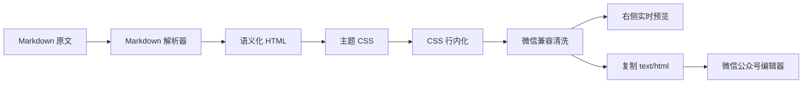
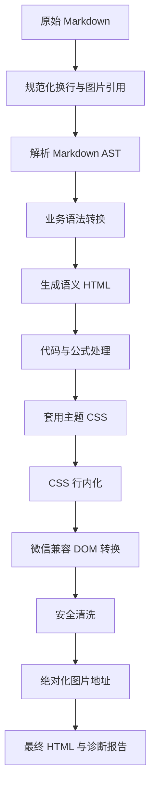
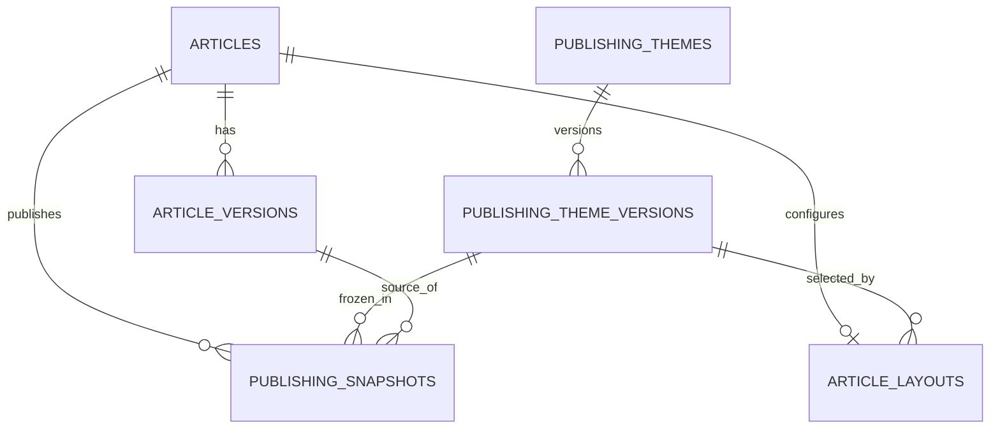
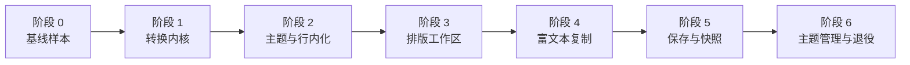

# 公众号原生排版模块设计与阶段验收方案

> 文档版本：1.0
> 编制日期：2026-08-06
> 适用项目：AI 内容生产工作台
> 当前状态：待评审、待开发
> 替代对象：当前课程详情中的 mdnice 发布稿、外部 mdnice 打开与自动截图能力

## 1. 文档目的

本文定义工作台原生公众号排版模块的产品边界、用户流程、页面结构、技术架构、数据模型、微信兼容规则、版本策略、安全要求、阶段计划和验收标准。

建设目标不是复制第三方网站的私有代码或主题，而是在工作台中自主实现以下等价能力：

1. 将公众号文章 Markdown 实时转换成适合微信公众号编辑器的富文本样式。
2. 在工作台内完成编辑、主题选择、桌面与手机预览、复制和历史结果查看。
3. 复制后将带行内样式的 `text/html` 写入剪贴板，粘贴到微信公众号编辑器时尽量保持预览效果。
4. 排版操作不依赖外部 mdnice 登录、Cookie、页面结构或网络可用性。
5. 文章内容、排版配置和最终发布快照分别管理，避免排版变更污染文章版本。
6. 继续遵守“用户显式保存后才持久化，未保存不新增文章版本”的既有约束。

## 2. 背景与现状

### 2.1 第三方编辑器的核心原理

通过公开页面和前端静态资源分析，类似 mdnice 的编辑器采用以下链路：



关键点不是截图，也不是复制普通 Markdown，而是把最终富文本 HTML 写入剪贴板的 `text/html` 类型。

### 2.2 工作台已有能力

当前项目已经具备：

- React 公众号文章详情页和 Tab 结构。
- `react-markdown` 与 `remark-gfm` 基础 Markdown 渲染。
- 公众号文章 Markdown 编辑、显式保存和统一版本管理。
- 图片资源解析、公开读取路径和 Markdown 图片引用。
- mdnice 发布稿预处理。
- 打开外部 mdnice 的入口。
- 后端 Playwright 自动打开 mdnice、填入 Markdown、选择主题并保存截图的任务。
- 后台任务、SSE 进度、运行记录和错误处理基础设施。

### 2.3 当前缺口

| 领域 | 当前状态 | 目标状态 |
|---|---|---|
| Markdown 渲染 | 普通阅读样式 | 统一且可扩展的公众号语义 HTML |
| 排版主题 | 无原生主题系统 | 内置主题与自定义主题 |
| 微信兼容 | 无专用转换 | 标签、样式、图片和公式兼容转换 |
| 富文本复制 | 仅复制 Markdown 文本 | 同时复制 `text/html` 与 `text/plain` |
| 预览 | 普通 Markdown 预览 | 与最终复制 HTML 使用同一份产物 |
| 排版持久化 | 无 | 主题配置、排版草稿与发布快照独立保存 |
| 历史追溯 | 只有截图记录 | 可追溯文章版本、主题版本与导出快照 |
| 外部依赖 | 依赖 mdnice 页面 | 默认完全本地运行 |

## 3. 建设目标与非目标

### 3.1 建设目标

1. 用户在课程详情中打开“公众号排版”即可加载当前公众号文章版本。
2. 左侧编辑 Markdown，右侧实时显示公众号效果。
3. 用户可切换主题、代码主题和预览宽度。
4. 用户可一键复制公众号富文本，并获得明确的成功或失败反馈。
5. 复制结果经过微信兼容处理，不包含脚本、事件属性、外链样式表等危险或无效内容。
6. 文章内容只在用户点击“保存文章”后写入并产生新版本。
7. 切换主题和调整排版参数不会产生文章内容版本。
8. 用户点击“保存排版”时保存排版配置；点击“生成发布快照”时保存不可变 HTML 快照。
9. 历史快照绑定文章版本、主题版本和图片清单，保证结果可追溯。
10. 原有 mdnice 外部自动化在新模块验收完成前保留为可回退能力。

### 3.2 非目标

1. 不复制或反编译第三方私有主题源码。
2. 不使用用户提供的第三方 Cookie、Token 或登录态作为工作台运行依赖。
3. 首期不直接调用微信公众号发布 API。
4. 首期不构建多人实时协同编辑。
5. 首期不提供任意 CSS、JavaScript 或远程资源执行能力。
6. 不把公众号排版操作加入课程内容生成工作流，排版属于生成完成后的显式人工操作。
7. 不因打开页面、自动预览或复制操作自动保存正文或创建文章版本。

## 4. 核心设计原则

### 4.1 单一渲染产物

右侧预览、富文本复制、HTML 快照和自动测试必须使用同一个转换内核生成的 HTML。禁止为预览和复制维护两套互不一致的渲染逻辑。

### 4.2 内容与样式分离

系统分别管理：

- 文章 Markdown：表达文章内容。
- 排版配置：表达选择的主题、代码主题和局部参数。
- 主题版本：表达可复用样式规则。
- 发布快照：表达某次准备发布的最终 HTML。

### 4.3 显式保存

- Markdown 编辑：只有点击“保存文章”才写入数据库并创建统一文章版本。
- 排版配置：只有点击“保存排版”才持久化。
- 发布快照：只有点击“生成发布快照”才创建。
- 实时预览：仅存在于浏览器内存，不触发任何保存。

### 4.4 安全优先

Markdown 和主题配置均视为不可信输入。最终 HTML 必须经过标签白名单、属性白名单、URL 协议检查和样式属性过滤。

### 4.5 渐进替换

新模块稳定前不直接删除原有 Playwright mdnice 自动截图。完成真实微信公众号粘贴验收后，再将外部能力降级为兼容入口，最终决定是否移除。

## 5. 用户角色与主要场景

当前仅面向工作台单用户，不区分复杂角色权限。

### 5.1 首次排版

1. 用户进入课程详情。
2. 打开“公众号排版”Tab。
3. 系统加载当前公众号文章版本和默认主题。
4. 用户查看右侧效果并切换主题。
5. 用户点击“复制到公众号”。
6. 系统复制富文本并提示复制成功。
7. 用户粘贴到微信公众号编辑器进行最终确认。

### 5.2 修改文章后排版

1. 用户在排版页编辑 Markdown。
2. 右侧实时预览更新，但数据库内容不变。
3. 页面显示“文章内容有未保存修改”。
4. 用户点击“保存文章”。
5. 系统持久化完整课程原稿与公众号文章统一版本。
6. 排版页绑定到新文章版本，并使旧审核结果按既有规则失效。

### 5.3 仅调整样式

1. 用户切换主题或修改主题参数。
2. 文章 Markdown 不变，不创建文章版本。
3. 用户点击“保存排版”后更新排版配置。
4. 需要固定发布结果时，用户点击“生成发布快照”。

### 5.4 查看历史发布结果

1. 用户打开排版记录。
2. 系统展示快照时间、文章版本、主题版本、图片数量和创建来源。
3. 用户可预览、复制或下载历史 HTML。
4. 历史快照不可直接修改；需要修改时从快照配置创建新的排版草稿。

## 6. 信息架构与页面设计

### 6.1 导航位置

不增加左侧一级菜单。课程详情现有 `mdnice` Tab 改为“公众号排版”。

课程详情建议保留：

```text
课程原稿｜公众号文章｜配套图片｜公众号排版｜审核｜版本
```

主题管理放入设置页面的二级页签：

```text
AI 配置｜Skill 配置管理｜排版主题
```

### 6.2 公众号排版主页面

页面采用工作台式三段结构，不使用嵌套卡片：

```text
┌────────────────────────────────────────────────────────────┐
│ 公众号排版  当前文章 V6  未保存状态  主题选择  预览模式  操作 │
├───────────────────────┬────────────────────────────────────┤
│                       │                                    │
│ Markdown 编辑区       │ 公众号富文本预览                   │
│                       │                                    │
│                       │                                    │
├───────────────────────┴────────────────────────────────────┤
│ 字数｜图片数｜转换警告｜最近保存时间｜当前主题版本          │
└────────────────────────────────────────────────────────────┘
```

桌面端编辑区与预览区默认比例为 `46% : 54%`，允许拖动分隔条。移动端改为“编辑｜预览”分段切换，不强行并排。

### 6.3 顶部工具栏

从左到右分组：

1. 页面名称与当前文章版本。
2. 内容状态：“已保存”或“有未保存修改”。
3. 主题选择器。
4. 预览宽度分段控制：桌面、手机。
5. 辅助操作：格式检查、排版记录。
6. 主操作：保存文章、保存排版、复制到公众号。

按钮规范：

- “复制到公众号”为主按钮。
- “保存文章”只在 Markdown 有变化时可用。
- “保存排版”只在主题或参数有变化时可用。
- 图标采用项目现有 Lucide 图标。
- 所有按钮具有统一悬停、按下、禁用和聚焦状态。
- 复制完成后按钮短暂显示“已复制”，不使用浏览器原生弹窗。

### 6.4 编辑区

首期可继续使用受控 `textarea`，第二期升级为 CodeMirror 6。编辑区提供：

- Markdown 语法高亮。
- 行号开关。
- 查找和替换。
- 撤销和重做。
- 图片引用提示。
- 未闭合链接、表格和代码围栏提示。
- 不自动保存。

首期不增加复杂可视化富文本编辑，避免 Markdown 与 HTML 双向转换造成内容损坏。

### 6.5 预览区

预览容器使用隔离 `iframe`，原因是：

- 防止公众号主题污染工作台全局 CSS。
- 便于计算完整文档 HTML。
- 便于复用为截图和视觉回归输入。
- 避免主题选择器影响设置页、侧边栏和弹窗。

预览宽度：

- 桌面：最大内容宽度 677px，模拟公众号编辑区域。
- 手机：375px 内容宽度，外层保持居中。
- 宽度切换不得改变最终复制 HTML，只改变预览容器。

### 6.6 转换问题面板

格式检查结果不使用浏览器弹窗，在页面右侧抽屉展示：

- 阻断问题：无法安全复制，例如危险链接、图片不可访问。
- 警告问题：可能与微信显示不同，例如复杂表格、超长代码行。
- 提示问题：可优化但不影响复制，例如图片缺少替代文字。

每条问题包含类型、位置、原因、处理建议和定位按钮。

### 6.7 排版记录

使用项目自研抽屉或弹窗展示：

- 快照编号。
- 文章统一版本。
- 主题名称与主题版本。
- 创建时间。
- HTML 字符数。
- 图片数量。
- 创建来源：手动快照或历史迁移。
- 操作：预览、复制、下载 HTML。

### 6.8 主题管理页面

列表字段：

- 主题名称。
- 简介。
- 类型：系统主题或自定义主题。
- 当前版本。
- 使用文章数。
- 更新时间。
- 状态。
- 操作。

系统主题可查看、复制，不可修改和删除。自定义主题可编辑、复制、停用和删除；已被历史快照引用的主题版本不可物理删除。

主题编辑页面分为：

- 左侧属性面板：基础、标题、正文、强调、引用、列表、代码、表格、图片、分隔线。
- 中间示例 Markdown。
- 右侧实时预览。

首期主题编辑采用受控表单，不开放任意 CSS 文本编辑。

## 7. Markdown 转换内核

### 7.1 推荐技术栈

考虑项目已经使用 `react-markdown` 和 `remark-gfm`，推荐继续采用 unified 生态：

| 层次 | 推荐组件 | 作用 |
|---|---|---|
| Markdown 解析 | `remark-parse` | 生成 Markdown AST |
| GFM | `remark-gfm` | 表格、删除线、任务列表 |
| Markdown 转 HTML AST | `remark-rehype` | 转为 HTML AST |
| 原始 HTML 策略 | 默认禁用，必要时 `rehype-raw` | 控制是否解析原始 HTML |
| HTML 输出 | `rehype-stringify` | 生成语义 HTML |
| 代码高亮 | Shiki 或 `rehype-highlight` | 生成代码 token 样式 |
| 公式 | 自定义纯文本公式规则，后续可选 KaTeX | 遵守工作台现有公式表达规范 |
| HTML 清洗 | DOMPurify 或服务端白名单清洗 | 删除危险标签与属性 |
| CSS 行内化 | `juice` | 将主题规则转换为行内 style |

为保证前后端一致，最终发布 HTML建议由后端 Node 辅助进程或 Python 内部稳定实现生成。首期可在前端完成实时预览，在后端通过固定测试向量验证相同转换规则；第二阶段将最终快照生成收口到后端服务。

### 7.2 处理流水线



### 7.3 Markdown 语义映射

| Markdown | HTML 语义 | 主题责任 |
|---|---|---|
| `#` | `h1` 或顶级标题 section | 字号、颜色、间距 |
| `##` | `h2` | 小节视觉标记 |
| `###` | `h3` | 次级标题样式 |
| 普通段落 | `p` | 字号、行高、段距 |
| `**重点**` | `strong` | 强调色与字重 |
| `> 引用` | `blockquote` | 边框、背景、内边距 |
| 列表 | `ul/ol/li` | 缩进、项目符号、间距 |
| 行内代码 | `code` | 字体、背景、圆角 |
| 代码块 | `pre > code` | 代码主题与横向溢出策略 |
| 表格 | `table` 或兼容结构 | 边框、单元格、窄屏策略 |
| 图片 | `img` 外包 `section` | 宽度、圆角、图注 |
| 分隔线 | `hr` 或兼容 section | 颜色与上下间距 |

### 7.4 项目专属内容规则

转换内核还要遵守工作台文章规范：

- 公众号版本不显示插图提示词。
- 公众号版本不显示“插图 1”等提示词标题。
- 图片引用保留原顺序。
- 封面图可在排版页作为文章顶部预览，但复制正文时提供“包含封面”开关；默认不把封面复制进正文。
- 数学公式使用易读普通表达式，例如 `Tanh(z) = (e^z - e^(-z)) / (e^z + e^(-z))`。
- 独立公式段落使用引用式视觉样式，但不改变公式文本本身。
- 不将公式文本重新转换成反斜杠 LaTeX 表达式。

## 8. 主题系统设计

### 8.1 主题组成

主题分为文章主题和代码主题：

- 文章主题：标题、正文、引用、列表、表格、图片等。
- 代码主题：代码背景、token 颜色、字体和行高。

文章主题可以选择一个代码主题。两者分别版本化，避免修改代码配色时复制整套文章主题。

### 8.2 主题令牌

主题配置使用受控 JSON，不保存任意可执行 CSS：

```json
{
  "name": "工作台清晰阅读",
  "description": "适合零基础 AI 课程的清晰科技主题",
  "tokens": {
    "fontFamily": "system-ui, sans-serif",
    "fontSize": 16,
    "lineHeight": 1.8,
    "textColor": "#262626",
    "mutedColor": "#6b7280",
    "primaryColor": "#087ea4",
    "accentColor": "#e7f6fa",
    "contentWidth": 677,
    "paragraphSpacing": 16
  },
  "components": {
    "h2": { "style": "left-bar" },
    "blockquote": { "style": "soft-panel" },
    "image": { "radius": 4, "caption": true }
  }
}
```

### 8.3 内置主题

首批建议提供四套主题：

1. 清晰阅读：低装饰、强调可读性，作为默认主题。
2. 科技课程：蓝青主色，适合 AI 课程，但避免整页单一深蓝。
3. 极简黑白：适合长文和高密度知识内容。
4. 活力讲解：使用克制的多色强调，适合零基础科普。

所有主题必须以同一份“主题能力样例文章”验收。

### 8.4 主题版本

- 创建主题时生成 V1。
- 保存主题修改时显式生成新主题版本。
- 历史主题版本不可变。
- 发布快照绑定具体主题版本，不绑定可变的“当前主题”。
- 停用主题不影响历史快照预览。

## 9. 微信兼容转换

### 9.1 HTML 标签策略

允许标签建议包括：

```text
section, p, span, strong, em, blockquote,
ul, ol, li, h1, h2, h3, h4,
pre, code, table, thead, tbody, tr, th, td,
img, a, br, hr
```

根据真实微信公众号粘贴结果，部分标签可在复制前降级为 `section`、`p` 和 `span`。

必须删除：

- `script`、`iframe`、`object`、`embed`、`form`。
- 所有 `on*` 事件属性。
- 外部 `<style>` 和 `<link>`。
- `javascript:`、`data:text/html` 等危险协议。
- 未进入白名单的 `data-*` 属性。

### 9.2 样式白名单

允许：

- 字体、字号、字重、行高、颜色、背景色。
- margin、padding、border、border-radius。
- text-align、text-decoration、white-space、word-break。
- display、width、max-width、height。
- 受控的 box-shadow。

禁止或降级：

- `position: fixed`、`position: sticky`。
- 任意负 `z-index` 和超大 `z-index`。
- 外部 `url()` 字体或背景资源。
- animation、transition、filter、backdrop-filter。
- CSS 变量作为最终复制产物。
- 依赖伪元素 `::before`、`::after` 的关键内容。

主题预处理必须把 CSS 变量和伪元素效果编译成普通行内样式或真实 DOM。

### 9.3 图片处理

- 最终复制 HTML 使用可被公众号后台读取的绝对 HTTPS 地址。
- 工作台本地 `127.0.0.1` 图片不能视为可发布地址。
- 复制前执行图片可访问性检查。
- 图片默认 `display: block; max-width: 100%; height: auto;`。
- 禁止 Base64 图片直接写入长文章剪贴板。
- 图片缺失时阻止生成正式发布快照；是否允许复制由用户显式确认。
- 图注使用普通文本节点，不依赖 CSS 伪元素。

### 9.4 表格处理

项目公众号写作规范原则上要求将复杂表格转为列表。排版模块仍需兼容历史表格：

- 两到四列表格可使用行内样式表格。
- 超过四列或内容过长时给出警告。
- 手机预览检测横向溢出。
- 首期不自动改写正文，只提示用户调整。

### 9.5 代码块处理

- 使用构建期生成的 token 行内颜色。
- 不依赖外部 CSS 类。
- 长行默认换行，避免公众号手机端横向滚动失效。
- 保留可复制文本，不把代码块渲染成图片。

### 9.6 公式处理

当前项目优先使用普通文本数学表达式。独立公式：

```text
> Tanh(z) = (e^z - e^(-z)) / (e^z + e^(-z))
```

转换后显示为有背景和左边框的公式段落。首期不引入 MathJax SVG，避免微信公众号复制后的兼容性和字体问题。后续确需复杂公式时，可增加“公式转图片”能力并作为独立资产管理。

## 10. 剪贴板设计

### 10.1 复制内容

一次复制同时写入：

```text
text/html  = 微信兼容后的最终富文本 HTML
text/plain = 原始 Markdown 或可读纯文本
```

优先使用现代 Clipboard API：

```ts
await navigator.clipboard.write([
  new ClipboardItem({
    "text/html": new Blob([html], { type: "text/html" }),
    "text/plain": new Blob([plainText], { type: "text/plain" }),
  }),
]);
```

浏览器不支持时降级为一次性的 `copy` 事件和 `document.execCommand("copy")`。降级路径必须有自动化测试。

### 10.2 复制反馈

- 成功：按钮显示“已复制”，持续约 1.8 秒。
- 权限拒绝：显示项目自研提示条，并提供“复制 HTML 文件”替代操作。
- 存在阻断问题：打开问题抽屉，不执行复制。
- 存在警告：允许复制，但按钮旁显示警告数量。
- 不使用 `alert`、`confirm` 或 `prompt`。

### 10.3 复制前检查

1. Markdown 非空。
2. 转换未产生未捕获异常。
3. 最终 HTML 非空。
4. HTML 不包含危险标签和属性。
5. 图片引用全部有可发布地址。
6. HTML 字符数不超过系统配置上限。
7. 关键章节未在转换中丢失。

## 11. 数据模型

### 11.1 `publishing_themes`

| 字段 | 类型 | 说明 |
|---|---|---|
| id | UUID | 主题 ID |
| key | string | 稳定标识 |
| name | string | 名称 |
| description | string | 简介 |
| type | enum | system/custom |
| status | enum | enabled/disabled |
| current_version_id | UUID | 当前版本 |
| created_at | datetime | 创建时间 |
| updated_at | datetime | 更新时间 |

### 11.2 `publishing_theme_versions`

| 字段 | 类型 | 说明 |
|---|---|---|
| id | UUID | 版本 ID |
| theme_id | UUID | 主题 ID |
| version_no | integer | 版本号 |
| schema_version | string | 配置契约版本 |
| config_json | JSON | 受控主题配置 |
| compiled_css | text | 经系统编译的 CSS |
| content_hash | string | 配置 Hash |
| created_at | datetime | 创建时间 |

### 11.3 `article_layouts`

每个公众号文章当前保留一份可变排版配置，不属于文章正文版本。

| 字段 | 类型 | 说明 |
|---|---|---|
| id | UUID | 排版配置 ID |
| article_id | UUID | 公众号文章 ID |
| article_version_id | UUID | 最近确认对应的文章版本 |
| theme_version_id | UUID | 主题版本 |
| code_theme_key | string | 代码主题 |
| options_json | JSON | 封面开关、图注等参数 |
| updated_at | datetime | 显式保存时间 |

### 11.4 `publishing_snapshots`

| 字段 | 类型 | 说明 |
|---|---|---|
| id | UUID | 快照 ID |
| article_id | UUID | 公众号文章 ID |
| article_version_id | UUID | 文章统一版本 |
| theme_version_id | UUID | 主题版本 |
| layout_hash | string | 排版配置 Hash |
| markdown_hash | string | Markdown Hash |
| html_path | string | 最终 HTML 文件相对路径 |
| html_hash | string | HTML Hash |
| image_manifest_json | JSON | 图片地址和 Hash 清单 |
| diagnostics_json | JSON | 转换诊断摘要 |
| created_at | datetime | 创建时间 |

### 11.5 版本关系



## 12. API 设计

### 12.1 主题

```text
GET    /api/publishing/themes
POST   /api/publishing/themes
GET    /api/publishing/themes/{theme_id}
PUT    /api/publishing/themes/{theme_id}
POST   /api/publishing/themes/{theme_id}/versions
POST   /api/publishing/themes/{theme_id}/clone
PATCH  /api/publishing/themes/{theme_id}/status
DELETE /api/publishing/themes/{theme_id}
```

### 12.2 渲染和检查

```text
POST /api/publishing/render
POST /api/publishing/validate
```

请求示例：

```json
{
  "articleId": "article-id",
  "articleVersionId": "version-id",
  "markdown": "# 标题",
  "themeVersionId": "theme-version-id",
  "options": {
    "includeCover": false,
    "showImageCaptions": false,
    "codeTheme": "github-light"
  }
}
```

响应包括：

- 最终 HTML。
- 可读纯文本。
- 转换诊断。
- Markdown Hash。
- 主题版本。
- 图片清单。

### 12.3 排版配置和快照

```text
GET  /api/articles/{article_id}/layout
PUT  /api/articles/{article_id}/layout
POST /api/articles/{article_id}/publishing-snapshots
GET  /api/articles/{article_id}/publishing-snapshots
GET  /api/publishing-snapshots/{snapshot_id}
GET  /api/publishing-snapshots/{snapshot_id}/html
```

所有保存接口必须携带当前文章版本或 Hash。文章在编辑期间被其他操作更新时返回冲突，不得覆盖新版本。

## 13. 后端模块设计

建议目录：

```text
backend/app/publishing/
├── renderer.py              # 组织完整转换流水线
├── markdown_parser.py       # Markdown 语义解析
├── theme_compiler.py        # 主题 JSON 编译为受控 CSS
├── css_inliner.py           # CSS 行内化
├── wechat_transformer.py    # 微信 DOM 兼容转换
├── sanitizer.py             # 标签、属性、URL 与样式清洗
├── diagnostics.py           # 阻断、警告和提示检查
├── snapshots.py             # 快照文件与 Hash 管理
└── schemas.py               # 输入输出契约
```

职责边界：

- 解析器不处理数据库。
- 主题编译器只接收受控配置。
- 清洗器必须是最终输出前不可跳过的步骤。
- 快照服务只保存已经校验通过的 HTML。
- API 层不拼接 HTML，不实现业务转换规则。

## 14. 前端模块设计

建议目录：

```text
src/features/publishing/
├── PublishingWorkspace.tsx
├── PublishingToolbar.tsx
├── MarkdownEditor.tsx
├── WechatPreview.tsx
├── ThemeSelector.tsx
├── PreviewModeControl.tsx
├── DiagnosticsDrawer.tsx
├── SnapshotDrawer.tsx
├── clipboard.ts
├── publishing-client.ts
└── publishing.types.ts
```

状态分为：

- `savedMarkdown`：服务器当前文章内容。
- `draftMarkdown`：本地未保存内容。
- `savedLayout`：服务器当前排版配置。
- `draftLayout`：本地未保存排版配置。
- `renderResult`：当前转换结果。
- `diagnostics`：当前诊断结果。

页面离开时如有未保存修改，使用项目自研确认弹窗分别说明“文章修改”和“排版修改”，不使用浏览器原生对话框。

## 15. 安全、隐私与合规

1. 不保存、不读取、不转发第三方 mdnice Cookie 或 Token。
2. API 日志不记录完整文章 HTML；只记录字符数、Hash、耗时和诊断数量。
3. 主题不允许 JavaScript、远程 CSS、远程字体和任意 HTML 模板。
4. 图片 URL 只允许 `https:` 和受控的工作台资源协议。
5. 所有快照路径解析后必须位于工作台运行目录。
6. 下载文件名必须清理路径分隔符和控制字符。
7. 最终 HTML 清洗规则必须有恶意输入回归测试。
8. 第三方主题只能通过受控 JSON 字段导入，不允许直接导入未知 CSS。

## 16. 性能与可靠性

### 16.1 性能目标

- 10,000 字 Markdown 首次转换 P95 小于 500ms。
- 普通输入后的增量预览在 300ms 防抖后完成。
- 30,000 字 Markdown 转换 P95 小于 1.5s。
- 预览滚动保持流畅，不因每次输入重建整个工作台页面。
- 复制操作在转换结果已就绪时 P95 小于 300ms。

### 16.2 稳定性策略

- 转换内核为纯函数，输入相同则 HTML 和诊断结果稳定。
- 主题版本、解析器版本和清洗器版本进入快照元数据。
- 转换失败保留上一次成功预览，并显示错误状态。
- 不因预览失败修改或清空用户 Markdown。
- 快照文件先写临时文件，校验 Hash 后原子替换。

## 17. 可观测性

记录以下脱敏字段：

- `request_id`
- `article_id`
- `article_version_id`
- `theme_version_id`
- `renderer_version`
- `markdown_chars`
- `html_chars`
- `image_count`
- `warning_count`
- `error_count`
- `duration_ms`
- `copy_result`

不记录：

- 完整 Markdown。
- 完整 HTML。
- Cookie、Token、API Key。
- 图片二进制或 Base64。

## 18. 分阶段实施计划

### 阶段 0：基线、原型与测试样本

目标：冻结当前行为，建立可重复的排版对照样本。

开发内容：

1. 选取模型原理第 1 课和第 2 课作为真实样本。
2. 新增主题能力样例 Markdown，覆盖全部语法组件。
3. 保存当前工作台普通预览截图。
4. 人工在 mdnice 中选择一个参考主题，保存参考截图和粘贴结果说明，不保存第三方 Cookie。
5. 建立微信公众号真实粘贴验收记录模板。
6. 冻结当前外部 mdnice 自动截图接口行为。

验收标准：

- 样例覆盖 H1-H4、段落、粗体、引用、列表、链接、图片、代码、表格、分隔线和公式。
- 两篇真实课程图片引用均可解析。
- 基线截图包含桌面和 375px 手机宽度。
- 文档明确哪些差异属于必须一致，哪些属于主题差异。

退出条件：测试样本和基线经人工确认后进入阶段 1。

### 阶段 1：确定性转换内核

目标：实现 Markdown 到安全、稳定 HTML 的无主题转换。

开发内容：

1. 建立独立 publishing 模块。
2. 实现 Markdown AST 解析和业务语法转换。
3. 实现图片地址解析。
4. 实现 HTML 标签、属性、URL 清洗。
5. 实现公式普通表达式和独立公式段落样式标记。
6. 实现转换诊断结构。
7. 建立固定输入输出快照测试。

验收标准：

- 相同输入重复转换得到相同 HTML Hash。
- 危险脚本、事件属性和危险 URL 全部被删除。
- 文章标题、章节、图片顺序和正文文本不丢失。
- 公众号版本不重新出现插图提示词。
- 模型原理第 1、2 课转换成功。
- 后端单元测试、Ruff、mypy 和前端构建通过。

退出条件：转换内核测试全部通过，未发现正文内容损坏。

### 阶段 2：主题系统与 CSS 行内化

目标：使最终 HTML 自包含，不依赖工作台样式表。

开发内容：

1. 新增主题与主题版本数据表。
2. 定义主题 JSON Schema。
3. 实现主题编译器。
4. 实现 CSS 行内化和微信样式白名单。
5. 建立四套内置主题。
6. 实现代码 token 行内样式。
7. 实现主题查询 API。

验收标准：

- 删除页面 `<style>` 后最终 HTML 仍保持核心排版。
- 最终 HTML 不包含 CSS 变量、关键伪元素依赖和外链样式表。
- 四套主题覆盖全部组件样例。
- 手机预览无横向溢出，最长英文单词不会撑破容器。
- 主题版本不可变，修改系统主题必须通过迁移产生新版本。
- 主题编译恶意输入测试通过。

退出条件：主题 HTML 可独立打开并保持预期样式。

### 阶段 3：公众号排版工作区

目标：替换当前只读 mdnice 发布稿页面，形成完整人工排版体验。

开发内容：

1. 将课程详情 `mdnice` Tab 显示名改为“公众号排版”。
2. 实现顶部工具栏、左右工作区和底部状态栏。
3. 实现 Markdown 编辑和实时预览。
4. 使用 iframe 隔离主题。
5. 实现桌面与手机预览切换。
6. 实现主题选择和本地未保存状态。
7. 实现转换问题抽屉。
8. 实现离开页面的自研确认弹窗。

验收标准：

- 页面风格与课程详情、Skill 管理和工作流页面一致。
- 桌面 1440×900、1280×720 和手机 390×844 下无重叠、截断和异常空白。
- 编辑、预览切换不改变 Markdown。
- 输入时不自动保存、不创建版本。
- 切换主题不创建文章版本。
- 图片左对齐、宽度和正文边界一致。
- Playwright 截图和控制台错误检查通过。

退出条件：用户可在工作台完成编辑、主题选择和稳定预览。

### 阶段 4：富文本复制与真实微信验收

目标：一键复制后能在微信公众号编辑器保留核心样式。

开发内容：

1. 实现 Clipboard API 富文本复制。
2. 实现 `execCommand` 降级路径。
3. 实现复制前阻断检查和结果反馈。
4. 增加“下载 HTML”替代操作。
5. 建立剪贴板内容自动化测试。
6. 使用真实微信公众号编辑器完成粘贴验收。

验收标准：

- 剪贴板同时包含 `text/html` 和 `text/plain`。
- 微信公众号编辑器中标题、正文、粗体、引用、列表、图片和代码核心样式保留。
- 不出现脚本、空白异常、整段丢失或乱码。
- 手机预览与微信手机预览的核心结构一致。
- 复制失败使用项目提示组件，不出现浏览器原生弹窗。
- Chrome 和 Edge 当前支持版本均通过复制测试。

退出条件：至少两篇真实课程、四套主题完成微信公众号粘贴验收。

### 阶段 5：排版保存、快照与历史追溯

目标：建立与文章版本分离、可审计的排版持久化能力。

开发内容：

1. 新增文章排版配置和发布快照数据表。
2. 实现“保存文章”“保存排版”“生成发布快照”三个独立动作。
3. 实现排版记录抽屉。
4. 实现历史 HTML 预览、复制和下载。
5. 实现文章 Hash 并发冲突保护。
6. 将快照关联文章版本、主题版本和图片清单。

验收标准：

- 仅编辑未保存时数据库无变化。
- 保存文章后统一课程版本只增加一次。
- 仅保存排版不增加文章版本。
- 每次生成发布快照产生独立不可变记录。
- 历史快照在主题更新后显示不变。
- 文章版本变化后页面明确提示重新确认排版。
- 并发 Hash 冲突不会覆盖较新内容。

退出条件：内容、排版和发布结果的版本边界全部通过集成测试。

### 阶段 6：主题管理与外部能力退役

目标：允许用户维护工作台自有主题，并完成旧 mdnice 依赖收口。

开发内容：

1. 在设置中增加“排版主题”页面。
2. 实现主题查看、新增、复制、编辑、停用和删除。
3. 实现系统主题只读保护。
4. 实现受控主题表单和实时预览。
5. 实现主题 JSON 导入导出。
6. 统计旧 mdnice 自动截图使用情况和失败率。
7. 将“打开 mdnice”降级为兼容入口，默认隐藏。
8. 评审是否删除 Playwright mdnice 自动化、相关任务表和接口。

验收标准：

- 新增和编辑弹窗或页面使用项目统一组件。
- 用户不能修改系统主题，但可以复制后编辑。
- 非法颜色、尺寸、CSS 和未知字段不能保存。
- 已被快照引用的主题版本不能删除。
- 导出后重新导入得到相同主题 Hash。
- 原生排版连续完成不少于 10 次真实文章复制，无外部 mdnice 依赖。
- 旧能力移除前提供数据迁移或明确保留策略。

退出条件：原生模块达到生产可用标准，外部依赖处理决策完成。

## 19. 综合测试矩阵

### 19.1 单元测试

- Markdown 节点映射。
- 图片地址绝对化。
- 插图提示词移除。
- 公式段落识别。
- HTML 标签和属性清洗。
- URL 协议过滤。
- 主题配置校验。
- CSS 行内化。
- 诊断规则。
- 剪贴板 payload 生成。

### 19.2 集成测试

- 文章读取、修改、显式保存和统一版本创建。
- 排版配置独立保存。
- 发布快照创建与历史读取。
- 主题更新后历史快照不变。
- 图片缺失时的阻断和恢复。
- 并发修改 Hash 冲突。
- 系统主题只读约束。

### 19.3 前端自动化测试

- 打开课程公众号排版页。
- 切换主题。
- 切换桌面和手机预览。
- 修改 Markdown 并验证未保存提示。
- 取消离开和确认离开。
- 保存文章和保存排版。
- 打开诊断抽屉和快照记录。
- 复制成功、权限拒绝和降级复制。

### 19.4 视觉回归

视口至少覆盖：

- 1440×900。
- 1280×720。
- 1024×768。
- 390×844。
- 375×667。

检查：

- 工具栏不重叠。
- 编辑器和预览尺寸稳定。
- 中文和英文长文本不溢出。
- 图片、代码和表格不撑破正文。
- 弹窗、抽屉和下拉框层级正确。
- 主题 CSS 不影响工作台外层页面。

### 19.5 真实微信公众号验收

人工验收记录必须包含：

- 测试日期。
- 浏览器版本。
- 微信公众号编辑器版本或页面日期。
- 文章版本。
- 主题版本。
- 复制前工作台截图。
- 粘贴后公众号编辑器截图。
- 手机预览截图。
- 差异列表。
- 是否通过。

## 20. 阶段验收报告模板

每个阶段完成后提交以下内容：

```markdown
# 阶段 N 验收报告

## 交付范围
- 已完成：
- 未完成：
- 变更文件：

## 自动化结果
- 后端测试：
- Ruff：
- mypy：
- 前端构建：
- Playwright：

## 人工验收
- 桌面端：
- 手机端：
- 微信粘贴：

## 数据检查
- 文章版本变化：
- 排版配置变化：
- 快照数量变化：

## 问题与风险
- 阻断问题：
- 遗留问题：
- 回滚方式：

## 验收结论
- 通过 / 有条件通过 / 不通过
```

## 21. 发布与回滚策略

### 21.1 功能开关

新增 `native_publishing_enabled` 配置：

- 关闭：显示当前 mdnice 发布稿页面。
- 开启：显示原生公众号排版页面。
- 测试环境默认开启，正式本地数据升级后再开启。

### 21.2 数据迁移

- 数据库迁移只新增表，不修改文章版本语义。
- 内置主题通过幂等迁移写入。
- 当前文章默认排版配置在首次打开时创建，但不创建文章版本。
- 旧 mdnice 截图继续可读，不强制迁移为发布快照。

### 21.3 回滚

- 阶段 1 至 4 可通过功能开关回到旧页面。
- 阶段 5 后回滚代码不得删除已生成的主题、排版配置和快照。
- 快照 HTML 作为不可变文件保留。
- 外部 mdnice 自动化只有在阶段 6 正式退役后才允许删除。

## 22. 风险与应对

| 风险 | 影响 | 应对 |
|---|---|---|
| 微信编辑器会清洗部分样式 | 粘贴结果与预览不同 | 使用真实粘贴测试建立兼容白名单 |
| 图片使用本地 URL | 公众号无法访问 | 复制前阻断并要求可发布 HTTPS 地址 |
| 前后端渲染逻辑不一致 | 预览与快照不同 | 单一转换内核或共享固定测试向量 |
| 允许任意 CSS | 安全与布局风险 | 受控主题 JSON 和样式白名单 |
| 长文章实时渲染卡顿 | 编辑体验差 | 300ms 防抖、缓存和 iframe 局部更新 |
| 主题修改影响历史文章 | 历史结果不可重现 | 主题版本和不可变 HTML 快照 |
| 自动保存误增版本 | 版本历史污染 | 所有保存动作显式触发并集成测试 |
| 公式复制兼容差 | 公式乱码或丢失 | 首期普通文本公式，复杂公式后续转图片 |
| 第三方页面变化 | 旧自动截图失败 | 原生模块不依赖第三方 DOM |

## 23. 完成定义

本模块全部完成必须同时满足：

1. 阶段 0 至阶段 6 全部通过验收。
2. 用户可在工作台内完成 Markdown 编辑、主题选择、桌面和手机预览以及公众号富文本复制。
3. 模型原理第 1、2 课和至少两篇其他系列课程完成真实微信公众号粘贴验收。
4. 文章内容、排版配置和发布快照三类版本边界经过自动化验证。
5. 页面不存在乱码、组件重叠、原生浏览器弹窗和明显风格不一致。
6. 最终 HTML 不包含危险标签、危险属性、远程脚本和第三方登录凭证。
7. 历史发布快照可预览、复制和下载，并能追溯到文章版本与主题版本。
8. 外部 mdnice 能力已经明确保留、隐藏或删除，不再作为默认发布链路依赖。

## 24. 推荐实施顺序总结



推荐严格按顺序实施。转换内核和微信兼容测试是整个模块的质量基础，不应先堆叠主题编辑器或复杂界面，再补转换规则。
